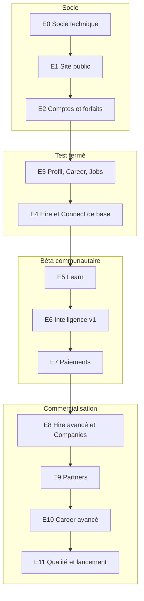

# 12 · Feuille de route par étapes

Douze étapes, de E0 à E11. Chaque étape livre une application **qui fonctionne** et qu'on peut montrer. On ne commence une étape que lorsque la précédente respecte sa « définition de fini ». Chaque étape se termine par une PR relue et fusionnée, et une mise à jour de `docs/journal.md` (ce qui a été fait, décisions, dettes).

Chaque bloc correspond à une phase de lancement de la note conceptuelle (§ 12).

| Étape | Résultat visible | Phase de lancement |
|---|---|---|
| E0 | Projet qui démarre, design system, CI | |
| E1 | Site public complet, navigable sans compte | |
| E2 | Inscription avec choix du forfait, connexion, moteur de droits, admin des forfaits | |
| E3 | Profil talent, CV, diagnostic simple, recherche d'offres, candidature gratuite | |
| E4 | Recruteur : offres, pipeline, messagerie, notifications | **Test fermé** (10 talents, 2 à 3 recruteurs, 20 jours) |
| E5 | Formations, lecteur, quiz, attestations | |
| E6 | Matching explicable, coach CV, analyse de CV, quotas IA | |
| E7 | Paiement Mobile Money et carte, abonnements, factures | **Bêta** (50 talents, 5 à 10 employeurs, 30 jours) |
| E8 | Équipes, permissions, grilles, viviers, entretiens, rapports, entreprise vérifiée | **Commercialisation** |
| E9 | Licences sponsorisées, espace partenaire, rapports agrégés | **Déploiement institutionnel** |
| E10 | Lettres, LinkedIn, simulations d'entretien texte et voix, portfolio | |
| E11 | Performance, PWA, accessibilité, SEO, observabilité, contenus | |

---

## E0 · Socle technique

**Objectif** : un projet propre sur lequel tout le reste se construit.

**Périmètre** : Next.js + TypeScript strict, Tailwind branché sur `ressources/jumanly-tokens.css`, police Sora, ESLint/Prettier, Prisma + PostgreSQL (Docker Compose en local), next-intl avec `messages/fr.json` **généré à partir de `textes/`** (script `scripts/build-messages.ts` qui lit les tableaux `| Clé | Texte |`), bibliothèque de composants de base (doc 11, § 11.5) et page `/dev/composants`, gabarits de mise en page (site public, espace connecté desktop et mobile), Vitest + Playwright, GitHub Actions, `.env.example`, `docs/journal.md`, `docs/decisions/`.

**Définition de fini** : `pnpm dev` démarre ; `pnpm lint`, `pnpm typecheck`, `pnpm test`, `pnpm build` passent en CI ; la page `/dev/composants` montre tous les composants avec leurs états ; aucun texte en dur.

**Prompt à coller dans Claude Code** :
> Lis CLAUDE.md puis docs/02-stack-technique.md, docs/03-architecture.md et docs/11-design-system.md. Réalise l'étape E0 décrite dans docs/12-feuille-de-route.md. Commence par me proposer ton plan en 10 lignes maximum, puis exécute-le. Écris le script qui convertit les fichiers textes/*.md en messages/fr.json. Termine en vérifiant la définition de fini et en mettant à jour docs/journal.md.

---

## E1 · Site public

**Objectif** : un visiteur comprend Jumanly et voit formations, offres et forfaits sans se connecter.

**Périmètre** : toutes les routes du doc 07 § 1 ; en-tête et pied de page publics ; formations et offres lues en base (seed de démonstration) avec recherche et filtres ; page `/tarifs` avec onglets et comparatifs lus depuis la table `Plan` (seed `plans.ts` créé dès cette étape) ; formulaire de contact envoyé par e-mail (adaptateur e-mail factice en local) ; métadonnées SEO, Open Graph, `sitemap.xml`, `robots.txt` ; bandeau cookies ; pages légales en gabarit.

**Définition de fini** : toutes les pages sont rendues côté serveur ; Lighthouse mobile ≥ 90 en performance, accessibilité, SEO sur `/`, `/formations`, `/offres`, `/tarifs` ; chaque bouton « Postuler », « Commencer » ou « Choisir » mène à `/inscription` avec les bons paramètres ; aucun numéro de téléphone nulle part.

**Prompt** :
> Réalise l'étape E1 (docs/12-feuille-de-route.md). Les pages sont listées dans docs/07-ecrans-et-fonctionnalites.md § 1, les textes dans textes/01-site-public.md et textes/05-forfaits-et-paiement.md, les forfaits dans docs/05-forfaits-roles-permissions.md. Crée le seed des forfaits avec toute la matrice de droits, et un seed de démonstration manifestement fictif. Respecte le design system (docs/11) et les maquettes de référence. Vérifie la définition de fini.

---

## E2 · Comptes, inscription avec forfaits, moteur de droits

**Objectif** : on s'inscrit en choisissant son profil et son forfait ; les droits s'appliquent partout.

**Périmètre** : Better Auth (e-mail + mot de passe, code de vérification, Google, lien magique), inscription en 6 étapes (doc 07 § 2, doc 06 § 6.2) avec `?profil=`, `?forfait=` et `?suite=` ; création automatique d'une organisation pour un recruteur ou une entreprise ; moteur de droits `can / level / limit / usage / consume` (doc 03 § 3.3) avec cache ; composant « verrou de forfait » et « jauge de quota » ; adaptateur de paiement **factice** pour tester les forfaits payants ; `/app/abonnement` (forfait actuel et quotas), `/app/parametres` (compte, sécurité, confidentialité, export et suppression) ; `/admin` minimal : utilisateurs, **forfaits et droits modifiables sans redéploiement** ; écran de bienvenue.

**Définition de fini** : tests unitaires du moteur de droits (chaque forfait du doc 05) ; test e2e « visiteur → choisit Pro sur /tarifs → s'inscrit → paie (factice) → arrive sur le tableau de bord avec Pro actif » ; test e2e « paie plus tard → compte Free » ; modifier un quota dans l'admin change le comportement sans redémarrage.

**Prompt** :
> Réalise l'étape E2. Sources : docs/05 (forfaits, droits, rôles), docs/06 § 6.2 et 6.7, docs/07 § 2, docs/03 § 3.3, docs/09 § 9.1 (adaptateur factice), docs/10 § 10.1, textes/02-inscription-connexion.md et textes/05-forfaits-et-paiement.md. Le code ne doit jamais tester un nom de forfait : uniquement des clés de droits. Écris les tests demandés dans la définition de fini.

---

## E3 · Profil talent, Career de base, Jobs

**Objectif** : un talent construit son profil et postule gratuitement.

**Périmètre** : `/app` (tableau de bord), `/app/profil` (sections, visibilité), référentiel de compétences (seed), `/app/career` (accueil), diagnostic **simplifié** sans IA (règles), éditeur de CV par sections avec 1 modèle (Free) et plusieurs modèles selon droit, export PDF ; `/app/jobs` (recherche, filtres, enregistrer), détail d'offre, **postuler** (CV + lettre facultative), `/app/jobs/candidatures` avec statuts ; reprise de l'action après inscription (`?suite=`).

**Définition de fini** : un talent Free peut créer son profil, générer un CV PDF, postuler à une offre et suivre sa candidature ; la candidature n'est jamais bloquée par un quota ou un forfait (test dédié).

**Prompt** :
> Réalise l'étape E3. Sources : docs/07 § 3, docs/04 (tables profil, Job, Application), docs/06 § 6.3, textes/03-espace-talent.md. Le matching n'existe pas encore : prévois l'emplacement du score sur le détail d'offre sans l'afficher. Écris le test qui garantit que postuler reste possible quel que soit le forfait.

---

## E4 · Hire et Connect de base (prêt pour le test fermé)

**Objectif** : un recruteur RH Free publie une offre, reçoit des candidatures, échange et décide.

**Périmètre** : `/app/hire` (tableau de bord), création d'offre guidée (compétences requises/souhaitées avec poids, critères éliminatoires en liste fermée), limite d'offres actives, pipeline avec étapes par défaut et glisser-déposer, fiche candidature, historique des décisions (`ApplicationEvent`), message de refus bienveillant ; messagerie liée aux candidatures, demandes de documents ; notifications in-app et e-mails (Resend, modèles React Email) ; sélecteur d'espace Personnel / Organisation ; invitations de membres selon `org.seats` ; modération des offres et signalements dans l'admin ; isolation par organisation.

**Définition de fini** : test e2e complet « recruteur publie → talent postule → recruteur fait avancer → message → décision → talent voit le statut » ; test d'isolation entre deux organisations ; e-mails visibles en local (aperçu React Email).

**Après E4** : déployer sur `staging`, lancer le **test fermé** (10 talents, 2 à 3 recruteurs, 20 jours), recueillir les retours dans `docs/retours-test-ferme.md`.

**Prompt** :
> Réalise l'étape E4. Sources : docs/07 § 4, docs/04 (Organization, Membership, Job, PipelineStage, Application, ApplicationEvent, Conversation, Message, Notification), docs/06 § 6.3 à 6.5, docs/10 § 10.2 et 10.7, textes/04-espace-recruteur-entreprise.md et textes/07-notifications-et-emails.md. Priorité à l'isolation des données entre organisations : écris d'abord les tests qui doivent échouer.

---

## E5 · Learn

**Objectif** : se former, être évalué, obtenir une attestation qui enrichit le profil.

**Périmètre** : catalogue connecté avec verrous selon `learn.catalog.level`, lecteur (vidéo HLS via l'adaptateur vidéo, supports, notes, questions), quiz, progression, attestation PDF avec page publique de vérification, compétences ajoutées au profil comme vérifiées ; éditeur de formations dans `/admin/formations` (rôle `content_editor`) ; leçons en aperçu visibles sur le site public.

**Définition de fini** : un éditeur crée une formation complète dans l'admin ; un talent Free suit une formation gratuite jusqu'à l'attestation ; une formation « fondamentale » est verrouillée en Free et ouverte en Starter.

**Prompt** :
> Réalise l'étape E5. Sources : docs/07 § 3 (Learn) et § 6 (admin formations), docs/04 (tables Learn), docs/06 § 6.9, textes/03-espace-talent.md (partie Learn). Prévois une lecture fluide sur réseau lent (qualité adaptative, choix manuel, supports téléchargeables).

---

## E6 · Intelligence v1 : matching explicable et IA

**Objectif** : chaque offre affiche un score expliqué ; le coach CV aide sans inventer.

**Périmètre** : tout le doc 08 : normalisation, score par critère, poids versionnés, explication JSON, bandes, critères éliminatoires signalés, vues talent et recruteur selon `hire.matching.level`, recommandations d'offres et de formations, embeddings + pgvector ; couche `src/server/ai` (consentement, droit, quota `ai.credits.monthly`, journal `AiUsage`, sorties Zod) ; analyse de CV à l'import (validation par le talent) ; coach CV avec Appliquer/Ignorer ; diagnostic personnalisé (Starter et plus) ; plan de progression ; signalement d'erreur et demande de révision ; `/admin/ia`.

**Définition de fini** : tests de matching (contrefactuels, monotonie, bornes, critères non applicables) ; un score affiché est identique au score recalculé depuis l'explication ; aucun appel IA sans consentement ni quota ; coût IA visible par fonction et par forfait dans l'admin.

**Prompt** :
> Réalise l'étape E6. Le document de référence est docs/08-matching-ia-explicable.md : respecte exactement ses règles, critères, poids, bandes et le format de l'explication. Textes dans textes/06-ia-et-matching.md. Les identifiants de modèles viennent des variables d'environnement. Commence par le calcul déterministe et ses tests, puis l'interface, puis les fonctions qui appellent le modèle.

---

## E7 · Paiements réels (prêt pour la bêta)

**Objectif** : payer un forfait par Mobile Money ou par carte, en toute fiabilité.

**Périmètre** : doc 09 complet ; adaptateur du fournisseur Mobile Money retenu et adaptateur carte ; webhooks signés et idempotents ; renouvellement prépayé, rappels, délai de grâce, retour au gratuit ; montée et réduction de gamme ; factures PDF ; `/admin/abonnements` (paiements, remboursements manuels) ; indicateurs de revenus dans `/admin`.

**Définition de fini** : parcours testés en bac à sable du fournisseur (succès, échec, expiration, webhook rejoué) ; une fin de délai de grâce ramène au gratuit sans perte de données.

**Après E7** : **bêta communautaire** (50 talents, 5 à 10 employeurs, 30 jours) ; mesurer la conversion Free vers payant et le coût IA par utilisateur.

**Prompt** :
> Réalise l'étape E7 selon docs/09-paiements-mobile-money.md. Le fournisseur retenu est [NOM DU FOURNISSEUR, à compléter] ; lis sa documentation officielle avant d'écrire l'adaptateur. Garde l'adaptateur factice pour les tests. Textes : textes/05-forfaits-et-paiement.md et textes/07-notifications-et-emails.md.

---

## E8 · Hire avancé et Companies

**Périmètre** : équipes et départements, attribution des offres, rôles `org_admin`, `hiring_manager`, `viewer`, permissions avancées ; grilles d'évaluation ; collaboration (commentaires, mentions) ; recherche dans le vivier avec demandes de mise en relation et consentement du talent ; viviers partagés ; entretiens et rendez-vous ; rapports par niveau et export ; vérification des entreprises (admin) et page entreprise publique ; entités et filiales (Company Premium) ; demande de devis.

**Prompt** :
> Réalise l'étape E8. Sources : docs/05 (matrice RH et Companies, rôles), docs/07 § 4, docs/06 § 6.5, docs/10 § 10.2 et 10.3, textes/04-espace-recruteur-entreprise.md. Chaque fonction doit être gouvernée par une clé de droit existante du doc 05.

---

## E9 · Jumanly Partners

**Périmètre** : lots de licences (admin), espace partenaire, codes et liens d'invitation, import CSV, activation `/activer`, abonnement `sponsored` et règles de priorité, rapports agrégés avec seuil de 10 personnes, export PDF.

**Prompt** :
> Réalise l'étape E9. Sources : docs/05 § 2.4 et § 6, docs/06 § 6.8, docs/07 § 5, docs/10 § 10.2, textes/09-admin-et-partenaires.md. Aucune donnée nominative ne doit atteindre l'espace partenaire : écris le test qui le garantit.

---

## E10 · Career avancé

**Périmètre** : lettres de motivation, biographie, correction de documents ; préparation LinkedIn ; adaptation du CV à une offre (Pro et plus) ; simulations d'entretien textuelles (Starter et plus) puis vocales (Pro et plus) avec quotas ; portfolio et page publique ; rapports détaillés de progression (Premium) ; exercices par métier.

**Prompt** :
> Réalise l'étape E10. Sources : docs/05 § 3.1, docs/07 § 3 (Career), docs/08 § 8.9, textes/03-espace-talent.md et textes/06-ia-et-matching.md. Commence par les simulations textuelles ; la voix vient ensuite, derrière un adaptateur de transcription et de synthèse configurable.

---

## E11 · Qualité et lancement commercial

**Périmètre** : PWA (installation, lecture hors ligne du profil et des leçons ouvertes), budget de performance, audit d'accessibilité complet, SEO (données structurées `JobPosting` et `Course`), Sentry et alertes, sauvegardes testées, contenus éditables dans `/admin/contenus`, traduction anglaise (si décidée), relecture juridique intégrée.

**Prompt** :
> Réalise l'étape E11. Fais d'abord un audit (performance, accessibilité, SEO, sécurité selon docs/10) et présente-moi la liste priorisée des corrections avant de les appliquer.

---

## Comment faire évoluer l'application ensuite

Pour toute nouvelle demande, utilise ce modèle de prompt :

> **Contexte** : [ce qui existe aujourd'hui, l'écran concerné]
> **Besoin** : [ce que l'utilisateur doit pouvoir faire]
> **Règles** : respecte CLAUDE.md ; si la fonction dépend du forfait, ajoute une clé de droit dans le seed et dans docs/05 ; ajoute les textes dans textes/ puis régénère messages/fr.json.
> **Fini quand** : [critères observables]
> Propose d'abord un plan court, puis réalise-le, puis mets à jour docs/journal.md.
