# Spécifications de l'application Jumanly

Tout le cahier des charges technique dans un seul fichier, en 12 parties. Dans le texte, « doc 05 » ou « docs/specifications.md (partie 05) » désigne la partie 05 de ce fichier.

## Sommaire

- Partie 01 · Vision et périmètre
- Partie 02 · Stack technique recommandée
- Partie 03 · Architecture
- Partie 04 · Modèle de données
- Partie 05 · Forfaits, rôles et permissions
- Partie 06 · Parcours utilisateurs
- Partie 07 · Écrans, routes et fonctionnalités
- Partie 08 · Matching IA explicable (Jumanly Intelligence)
- Partie 09 · Paiements : Mobile Money et carte
- Partie 10 · Sécurité, confidentialité et conformité
- Partie 11 · Design system de l'application
- Partie 12 · Feuille de route par étapes

---

## Partie 01 · Vision et périmètre

### Le produit en une phrase

Jumanly est une plateforme web africaine qui relie **se former, enrichir son profil, candidater et être recruté** dans un seul parcours, pour les talents, les professionnels RH, les entreprises et les institutions partenaires.

Slogan : **Learn. Grow. Connect.** · Une plateforme développée par **The Growth Lab**.

### Vision et mission (note conceptuelle v2.0)

- **Vision** : construire une plateforme africaine de référence qui facilite le développement des compétences, la progression professionnelle et la rencontre entre talents et employeurs.
- **Mission** : accompagner les individus dans la construction de leur trajectoire professionnelle et permettre aux organisations d'identifier, d'évaluer et de recruter plus efficacement les compétences dont elles ont besoin.
- **Positionnement** : à l'intersection de l'EdTech (apprentissage), de la CareerTech (profil, candidature, préparation) et de la HRTech (recherche de talents, ATS). L'ambition n'est pas d'empiler des services mais de **les connecter** pour une expérience continue.

### Les publics

| Public | Besoin principal | Famille de forfaits |
|---|---|---|
| Talents : étudiants, jeunes diplômés, chercheurs d'emploi, professionnels | Se former, construire un profil, postuler, se préparer | Jumanly for Talents |
| Professionnels RH : recruteurs indépendants, consultants, petites équipes | Publier, trier, échanger, décider | Jumanly for RH |
| Entreprises : PME, grands groupes | Recruter à plusieurs, piloter | Jumanly for Companies |
| Institutions : banques, universités, fondations, ONG, programmes publics | Financer l'accès de bénéficiaires et mesurer l'impact | Jumanly Partners |

### Les modules

| Module | Rôle | Public |
|---|---|---|
| **Learn** | Formations vidéo, supports, exercices, évaluations, attestations | Talents |
| **Career** | Diagnostic, CV, lettres, biographie, portfolio, LinkedIn, plan de progression, coach IA, simulations d'entretien | Talents |
| **Jobs** | Offres d'emploi, stages et missions ; enregistrer, postuler, suivre | Talents |
| **Hire** | Publication d'offres, recherche de talents, ATS, évaluation | RH, entreprises |
| **Connect** | Messagerie, invitations, demandes de documents, rendez-vous, notifications | Tous |
| **Intelligence** (transverse) | IA, analyse documentaire, recommandations, **matching explicable** | Tous |
| **Admin** (transverse) | Accès, abonnements, contenus, rapports | Équipe Jumanly |

### Principes non négociables

1. **Une partie publique riche, sans connexion.** Le visiteur voit ce qu'est Jumanly, les formations, les offres d'emploi et les forfaits avant de créer un compte. Les forfaits (Free et payants) sont proposés **au moment de l'inscription**.
2. **Candidater est gratuit, toujours.** Aucun forfait, quota ou option ne conditionne une candidature. Les profils Free sont recrutés au même titre que les abonnés.
3. **L'IA recommande, l'humain décide.** Le matching classe et explique ; il ne rejette jamais personne automatiquement. Chaque score a un « Pourquoi ? ».
4. **Confidentialité par défaut.** Le talent choisit qui voit son profil. Les partenaires ne voient que des données agrégées. Les quotas empêchent l'extraction massive.
5. **Droits paramétrables.** Forfaits, droits et quotas se modifient depuis l'admin, sans redéploiement.
6. **Pensée pour l'Afrique et le mobile.** Mobile d'abord, pages légères, réseau lent toléré, Mobile Money, prix en USD.
7. **Une seule identité de compte.** Une personne a un compte personnel, un profil talent, et peut aussi être membre d'une ou plusieurs organisations.
8. **Contact par e-mail uniquement** : assistant@jumanly.io et infojumanly@gmail.com. Aucun numéro de téléphone nulle part.

### Hors périmètre de la première version

- Application mobile native (le web est responsive et installable en PWA).
- Prélèvement automatique Mobile Money (abonnement prépayé par période, voir doc 09).
- Accompagnement par un expert humain (option séparée, plus tard).
- Intégrations avec des outils RH tiers (Company Premium, plus tard).
- Langue anglaise : prévue dans l'architecture (i18n) mais textes à traduire plus tard.

### Lancement (note § 12)

| Phase | Qui | Durée | Ce qui doit être prêt |
|---|---|---|---|
| 1. Test fermé | 10 talents, 2 à 3 recruteurs | 20 jours | Étapes E0 à E4 de la feuille de route |
| 2. Bêta communautaire | 50 talents, 5 à 10 employeurs | 30 jours | Étapes E5 à E7 |
| 3. Commercialisation | Public, puis réseau de recruteurs et entreprises | | Étapes E8, E10, E11 |
| 4. Déploiement institutionnel | Cohortes sponsorisées | | Étape E9 |

### Indicateurs à suivre dès le départ (note § 11)

Utilisateurs gratuits et payants ; conversion Free vers payant ; revenu mensuel récurrent ; renouvellement ; coût d'acquisition ; coût de fonctionnement par utilisateur ; dépenses d'IA ; marge brute par formule ; comptes entreprises actifs ; revenus institutionnels. L'architecture doit enregistrer les événements nécessaires (doc 03, § Analytique).

---

## Partie 02 · Stack technique recommandée

Choix guidés par : une petite équipe, un développement assisté par Claude Code, un public mobile en Afrique (réseau variable), un budget maîtrisé, et une évolution par étapes. Chaque choix est remplaçable, mais **il faut s'y tenir sauf raison documentée** dans `docs/decisions/` (une note courte par décision).

### Résumé

| Couche | Choix | Pourquoi |
|---|---|---|
| Langage | **TypeScript** strict partout | Un seul langage front et back, typage partagé |
| Framework | **Next.js** (App Router, React Server Components, Server Actions) | Pages publiques rendues côté serveur (SEO, vitesse), espace connecté dans la même base de code |
| UI | **Tailwind CSS** + composants maison inspirés de **shadcn/ui** (Radix UI pour l'accessibilité) | Contrôle total du rendu Jumanly, accessibilité intégrée |
| Icônes | Jeu Jumanly (SVG, 24 px, trait 2 px) dans `identite-visuelle/elements-graphiques/icones/`, complété par **lucide-react** au même style | Cohérence avec la charte |
| Police | **Sora** via `next/font/google` (300 à 700) | Charte |
| Formulaires | **React Hook Form** + **Zod** | Validation partagée client/serveur |
| Base de données | **PostgreSQL 16** + extension **pgvector** | Relationnel solide + recherche sémantique pour le matching |
| ORM | **Prisma** | Schéma lisible, migrations, seed |
| Authentification | **Better Auth** (e-mail + mot de passe, code de vérification, Google, lien magique ; plugin organisations) | Organisations et rôles natifs, auto-hébergé |
| Internationalisation | **next-intl**, français par défaut, anglais prévu | Textes hors du code |
| Tâches de fond | **Inngest** (ou BullMQ + Redis si auto-hébergé) | Analyses IA, e-mails, renouvellements, rappels |
| Cache et limites | **Redis** (Upstash en géré) | Limitation de débit, quotas rapides |
| Fichiers | Stockage compatible **S3** (Cloudflare R2 recommandé : pas de frais de sortie) | CV, attestations, médias |
| Vidéo | **Bunny Stream** (ou Mux) avec lecture adaptative HLS | Coût et débit adaptatif sur réseau lent |
| E-mails | **Resend** + **React Email** | Modèles en React, délivrabilité |
| IA | **API Claude** (SDK `@anthropic-ai/sdk`) derrière une couche `ai/` | Coach, analyse de CV, explications ; modèles configurables par variable d'environnement |
| Embeddings | Fournisseur d'embeddings multilingue (configurable) stocké dans pgvector | Similarité sémantique pour le matching |
| Voix (simulations) | Transcription + synthèse vocale via fournisseurs configurables | Étape E10 seulement |
| Paiements | Couche `payments/` avec adaptateurs : agrégateur **Mobile Money** + **carte** | Voir doc 09 |
| PDF | **@react-pdf/renderer** | CV, attestations, factures, rapports |
| Tests | **Vitest** (unitaires), **Playwright** (bout en bout), **axe-core** (accessibilité) | |
| Qualité | ESLint, Prettier, `tsc --noEmit`, Husky + lint-staged | |
| CI | **GitHub Actions** : lint, types, tests, build, migration à blanc | |
| Hébergement | **Vercel** (app) + **Neon** ou **Supabase** (Postgres) au démarrage ; migrable vers un VPS/Docker | Démarrage rapide ; région européenne la plus proche de l'Afrique centrale |
| Observabilité | **Sentry** (erreurs), journaux structurés (pino), **PostHog** (analytique produit, auto-hébergeable) | |

### Modèles d'IA

Les identifiants de modèles sont des **variables d'environnement**, jamais écrits en dur :

```env
AI_MODEL_DEFAULT=claude-sonnet-5-5     # coach CV, diagnostic personnalisé, simulations, explications
AI_MODEL_FAST=claude-haiku-5-5         # extraction de CV, classification, résumés courts
AI_MAX_TOKENS_DEFAULT=2000
```

Toute fonction IA passe par `src/server/ai/` qui : vérifie le droit et le quota, appelle le modèle, journalise le coût (tokens entrée/sortie, modèle, fonction, utilisateur, forfait), et renvoie une réponse **structurée** (JSON validé par Zod).

### Arborescence du dépôt

```
jumanly/
├── CLAUDE.md                  ← règles pour Claude Code (fourni)
├── docs/                      ← ce cahier des charges (fourni)
├── textes/textes-application.md ← tous les textes (fournis), convertis en messages/fr.json
├── messages/fr.json           ← généré depuis textes/ à l'étape E0
├── prisma/
│   ├── schema.prisma
│   ├── migrations/
│   └── seed/ (plans.ts, demo.ts)
├── public/ (logos, favicon, images)
├── src/
│   ├── app/
│   │   ├── (public)/          ← site public : /, /formations, /offres, /tarifs…
│   │   ├── (auth)/            ← /connexion, /inscription…
│   │   ├── app/               ← espace connecté /app/…
│   │   ├── admin/             ← /admin/…
│   │   └── api/               ← webhooks (paiements, vidéo), auth
│   ├── components/
│   │   ├── ui/                ← boutons, champs, cartes, badges, onglets…
│   │   ├── brand/             ← logo, orbe IA, motifs
│   │   └── modules/           ← learn/, career/, jobs/, hire/, connect/
│   ├── server/
│   │   ├── auth/
│   │   ├── entitlements/      ← can(), quota(), consume()
│   │   ├── matching/          ← score, explication, recommandations
│   │   ├── ai/                ← client IA, prompts, journal des coûts
│   │   ├── payments/          ← interface + adaptateurs
│   │   ├── notifications/     ← in-app + e-mails
│   │   └── services/          ← logique métier par module
│   ├── lib/ (utils, validations zod, formats)
│   └── styles/tokens.css      ← jumanly-tokens.css
├── emails/                    ← modèles React Email
└── tests/ (unit/, e2e/)
```

### Variables d'environnement (`.env.example`)

```env
DATABASE_URL=
BETTER_AUTH_SECRET=
BETTER_AUTH_URL=http://localhost:3000
GOOGLE_CLIENT_ID=
GOOGLE_CLIENT_SECRET=
RESEND_API_KEY=
EMAIL_FROM="Jumanly <assistant@jumanly.io>"
CONTACT_EMAIL_PRO=assistant@jumanly.io
CONTACT_EMAIL_GENERAL=infojumanly@gmail.com
S3_ENDPOINT=
S3_BUCKET=
S3_ACCESS_KEY_ID=
S3_SECRET_ACCESS_KEY=
VIDEO_PROVIDER=bunny
BUNNY_STREAM_LIBRARY_ID=
BUNNY_STREAM_API_KEY=
ANTHROPIC_API_KEY=
AI_MODEL_DEFAULT=claude-sonnet-5-5
AI_MODEL_FAST=claude-haiku-5-5
EMBEDDINGS_PROVIDER=
NEXT_PUBLIC_VOICE_PROVIDER=browser   # voix des simulations : browser (navigateur) ou none
EMBEDDINGS_API_KEY=
PAYMENTS_MOBILE_MONEY_PROVIDER=        # à choisir, voir docs/specifications.md (partie 09)
PAYMENTS_MOBILE_MONEY_API_KEY=
PAYMENTS_MOBILE_MONEY_WEBHOOK_SECRET=
PAYMENTS_CARD_PROVIDER=
PAYMENTS_CARD_API_KEY=
PAYMENTS_CARD_WEBHOOK_SECRET=
REDIS_URL=
INNGEST_EVENT_KEY=
INNGEST_SIGNING_KEY=
SENTRY_DSN=
APP_VERSION=
BACKUP_DIR=
RESTORE_CHECK_DATABASE_URL=
NEXT_PUBLIC_POSTHOG_KEY=
NEXT_PUBLIC_SITE_URL=https://jumanly.io
```

### Performance sur réseau lent

- Pages publiques en rendu serveur, images en AVIF/WebP avec `next/image`, pas de bibliothèque d'animation lourde.
- Vidéo en HLS adaptatif, choix manuel de qualité, téléchargement des supports PDF.
- PWA : manifeste, icônes, cache des pages consultées (lecture hors ligne du profil et des leçons déjà ouvertes à l'étape E11).
- Budget : 200 Ko de JS compressé maximum par page publique ; contrôle dans la CI (`@next/bundle-analyzer`).

---

## Partie 03 · Architecture

### 3.1 Vue d'ensemble

Une seule application Next.js (monolithe modulaire), une base PostgreSQL, des tâches de fond, et des services externes derrière des interfaces remplaçables.

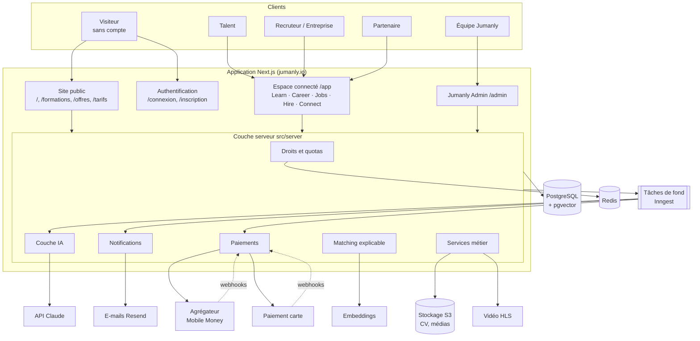

### 3.2 Couches et règles de dépendance

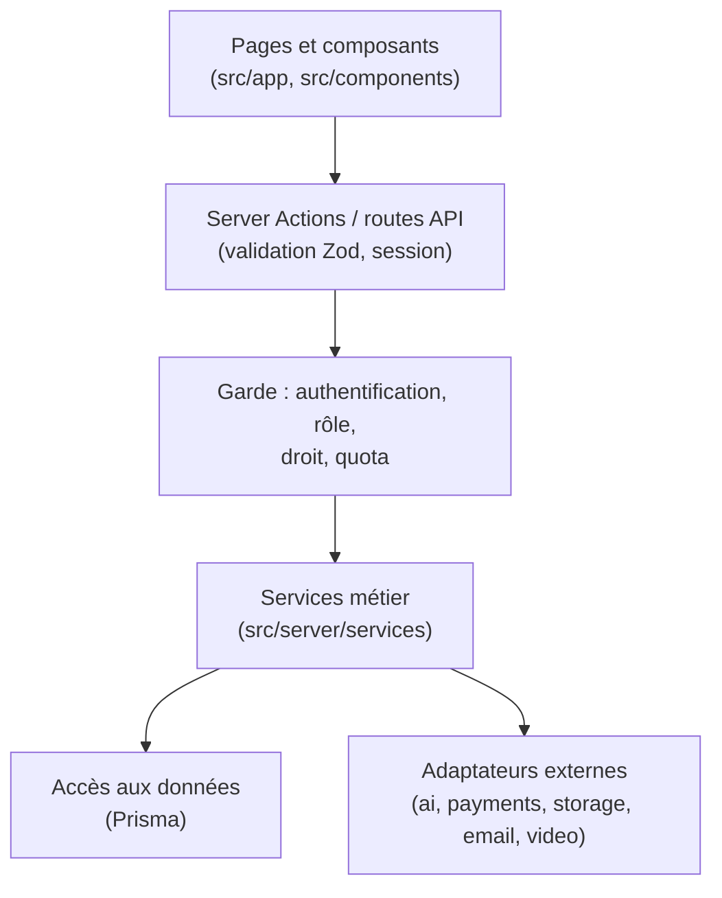

- Un composant ne parle **jamais** directement à Prisma ni à un service externe.
- Toute écriture passe par une Server Action ou une route API qui : valide l'entrée (Zod), vérifie la session, le rôle, le droit (`can`) et le quota (`consume`), puis appelle un service.
- Les services sont testables sans Next.js.
- Les adaptateurs externes ont une interface et une implémentation factice (`fake`) pour le développement et les tests.

### 3.3 Moteur de droits (`src/server/entitlements`)

```ts
can(subject, key): Promise<boolean>              // fonctionnalité
level(subject, key): Promise<string>             // niveau (ex. "fundamentals")
limit(subject, key): Promise<number>             // capacité ou quota (-1 = illimité)
usage(subject, key): Promise<{ used, limit, resetsAt }>
consume(subject, key, amount = 1): Promise<void> // lève QuotaExceededError
```

- `subject` = un utilisateur (forfait Talent) ou une organisation (forfait RH/Company).
- Résolution : licence sponsorisée active > abonnement payant actif > forfait gratuit de la famille.
- Les droits résolus sont mis en cache 60 s dans Redis et invalidés à chaque changement d'abonnement ou de forfait.
- `consume` est atomique (transaction ou `INCR` Redis réconcilié en base).

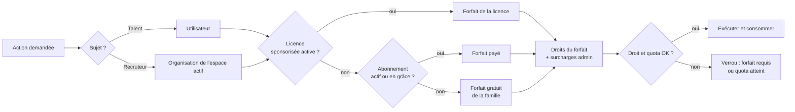

### 3.4 Multi-organisation

- Un `User` a un `TalentProfile` (toujours) et zéro ou plusieurs `Membership` dans des `Organization`.
- L'espace actif (personnel ou organisation) est stocké dans la session ; toutes les requêtes Hire sont filtrées par `organizationId` (pas de fuite entre organisations ; tests obligatoires).
- Une organisation de type `partner` a un espace partenaire au lieu de Hire.

### 3.5 Tâches de fond

| Événement | Tâche |
|---|---|
| `cv.uploaded` | Extraction du texte, analyse structurée (IA rapide), mise à jour des compétences proposées au talent (à valider par lui) |
| `profile.updated`, `job.published` | Recalcul des embeddings et des scores de compatibilité concernés |
| `application.created` | Score et explication figés pour la candidature, notification au recruteur |
| `subscription.renewal_due` | Rappels J-7, J-3, J-0 |
| `subscription.grace_ended` | Retour au forfait gratuit |
| `quota.threshold` | Alerte 80 % et 100 % |
| `weekly.digest` | Résumé hebdomadaire (offres compatibles, progression) |
| `payment.webhook` | Confirmation d'un paiement, activation |

Chaque tâche est idempotente (clé d'idempotence) et rejouable.

### 3.6 Analytique et audit

- **Événements produit** (PostHog) : `signup_started`, `plan_selected`, `signup_completed`, `payment_succeeded`, `course_started`, `course_completed`, `application_submitted`, `hire_recorded`, `ai_feature_used`, `quota_reached`, `upgrade_clicked`. Jamais de contenu personnel dans les propriétés.
- **Journal d'audit** (table `AuditLog`) : changements de rôle, de forfait, de droits, décisions de recrutement, consultations de profil par un recruteur, exports, actions admin.
- **Journal IA** (table `AiUsage`) : fonction, modèle, tokens, coût estimé, sujet, forfait. Alimente le coût IA par formule (note § 11).

### 3.7 Environnements

| Environnement | Usage | Données |
|---|---|---|
| `local` | Développement | Seed de démonstration, adaptateurs factices |
| `preview` | Chaque PR | Base éphémère, seed de démonstration |
| `staging` | Test fermé et bêta | Données de test réelles, paiements en mode bac à sable |
| `production` | Public | Réelles |

---

## Partie 04 · Modèle de données

Base PostgreSQL via Prisma. Identifiants en `cuid2`, dates en UTC (`timestamptz`), montants en **centimes USD** (entier), suppression logique (`deletedAt`) pour les données personnelles avec purge planifiée. Ce schéma est un **point de départ** : Claude Code l'écrit en Prisma à l'étape où chaque table devient nécessaire.

### 4.1 Diagramme entité-relation (cœur)

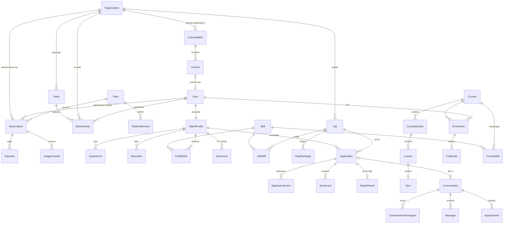

### 4.2 Tables principales

#### Identité et organisations

| Table | Champs clés |
|---|---|
| `User` | id, email (unique), emailVerified, name, image, country, city, locale (`fr`), platformRole (`user`/`content_editor`/`support_agent`/`platform_admin`), status (`active`/`suspended`), aiConsent (bool, date), createdAt |
| `Session`, `Account`, `Verification` | gérées par Better Auth |
| `Organization` | id, type (`recruiter`/`company`/`partner`), name, slug, logo, description, website, country, city, sector, size, verifiedAt, verifiedBy, parentId (entités et filiales) |
| `Membership` | userId, organizationId, role (`org_owner`/`org_admin`/`recruiter`/`hiring_manager`/`viewer`/`partner_manager`), teamId?, status (`invited`/`active`/`removed`), invitedBy |
| `Team` | organizationId, name, kind (`team`/`department`) |
| `Invitation` | organizationId, email, role, token, expiresAt, acceptedAt |

#### Forfaits, abonnements, paiements

| Table | Champs clés |
|---|---|
| `Plan` | code (unique, ex. `talent_pro`), family (`talent`/`rh`/`company`/`partner`), name, tagline, priceCents (null = sur devis), currency (`USD`), interval (`month`), isPublic, isPurchasable, recommended, sortOrder, active |
| `PlanEntitlement` | planId, key (ex. `ai.credits.monthly`), type (`boolean`/`level`/`limit`), value (texte : `true`, `fundamentals`, `150`) |
| `EntitlementOverride` | subjectType (`user`/`organization`), subjectId, key, value, reason, expiresAt (geste commercial, contrat Premium) |
| `Subscription` | subjectType, subjectId, planId, status (`trialing`/`active`/`past_due`/`canceled`/`expired`/`sponsored`), currentPeriodStart, currentPeriodEnd, cancelAtPeriodEnd, pendingPlanId (réduction en fin de période), source (`self`/`license`/`admin`) |
| `Payment` | subscriptionId, provider, method (`mobile_money`/`card`), operator (ex. `mpesa`, `orange`, `airtel`), msisdnMasked, amountCents, currency, status (`pending`/`succeeded`/`failed`/`expired`/`refunded`), providerRef (unique), idempotencyKey, rawPayload (JSON, chiffré), paidAt |
| `Invoice` | paymentId, number (séquentiel), pdfUrl, issuedAt |
| `UsageCounter` | subjectType, subjectId, key, periodStart, periodEnd, used |
| `LicenseBatch` | partnerOrgId, planId, seats, startsAt, endsAt, contractRef, priceCents |
| `License` | batchId, code (unique), invitedEmail?, userId?, activatedAt, status (`available`/`active`/`revoked`/`expired`) |

#### Profil talent

| Table | Champs clés |
|---|---|
| `TalentProfile` | userId, headline, summary, yearsExperience (calculé), availability (`immediate`/`1_month`/`3_months`/`not_looking`), desiredContracts[] (`cdi`/`cdd`/`stage`/`mission`/`freelance`/`alternance`), desiredLocations[], remotePreference (`onsite`/`hybrid`/`remote`/`any`), salaryExpectation (min, max, devise, optionnel), languages (JSON : code + niveau CECRL), visibility (`private`/`recruiters`/`anonymous`), completeness (0-100), embedding (vector) |
| `Experience` | profileId, title, company, location, startDate, endDate?, description, skills[] |
| `Education` | profileId, school, degree, level (`secondaire`/`bac`/`bac_plus_2`/`licence`/`master`/`doctorat`/`certification`), field, startDate, endDate |
| `Skill` | id, name, slug, aliases[], category, embedding (référentiel commun, enrichi par l'admin) |
| `ProfileSkill` | profileId, skillId, level (1 à 4 : notions, intermédiaire, avancé, expert), source (`declared`/`course`/`assessment`/`cv_extracted`), verified (bool), evidenceId? (attestation) |
| `Document` | profileId, kind (`cv`/`cover_letter`/`bio`/`portfolio_item`/`other`), title, templateId, content (JSON structuré), fileUrl, isPrimary |
| `CareerDiagnostic` | userId, level (`simple`/`personalized`), answers (JSON), result (JSON), createdAt |
| `ProgressPlan` | userId, goals (JSON), steps (JSON), updatedAt |
| `InterviewSession` | userId, mode (`text`/`voice`), jobTitle, transcript (JSON), feedback (JSON), createdAt |

#### Jobs et Hire

| Table | Champs clés |
|---|---|
| `Job` | organizationId, createdBy, assignedTo?, teamId?, title, slug, description, responsibilities, contractType, location (ville, pays), remote (`onsite`/`hybrid`/`remote`), salaryMin?, salaryMax?, currency, experienceMin (années), educationLevelMin?, languagesRequired (JSON), knockoutCriteria (JSON, explicites), status (`draft`/`published`/`closed`/`archived`), publishedAt, closesAt, embedding |
| `JobSkill` | jobId, skillId, importance (`required`/`preferred`), weight (1 à 5), minLevel (1 à 4) |
| `PipelineStage` | jobId, name, order, kind (`new`/`screening`/`test`/`interview`/`offer`/`hired`/`rejected`) |
| `Application` | jobId, profileId, stageId, status (`active`/`withdrawn`/`rejected`/`hired`), coverLetter?, documentIds[], source (`direct`/`invitation`/`talent_search`), createdAt |
| `ApplicationEvent` | applicationId, actorId, type (`stage_changed`/`note`/`message`/`document_requested`/`decision`), payload (JSON), createdAt (historique des décisions) |
| `Scorecard` | applicationId, reviewerId, criteria (JSON : critère, note 1-5, commentaire), recommendation (`strong_yes`/`yes`/`no`/`strong_no`), createdAt |
| `MatchResult` | profileId, jobId, score (0-100), band, breakdown (JSON), explanation (JSON), modelVersion, weightsVersion, computedAt (figé dans `Application` au moment de la candidature) |
| `MatchFeedback` | matchResultId, userId, kind (`error_report`/`review_request`/`useful`/`not_useful`), comment, status, resolvedBy |
| `TalentPool` | organizationId, name, shared (bool) |
| `TalentPoolEntry` | poolId, profileId, addedBy, note |
| `ContactRequest` | organizationId, requesterId, profileId, jobId?, message, status (`pending`/`accepted`/`declined`/`expired`) |
| `SavedJob` | userId, jobId |

#### Learn

| Table | Champs clés |
|---|---|
| `Course` | slug, title, summary, description, category, level, durationMinutes, coverUrl, requiredLevel (`free`/`fundamentals`/`standard`/`advanced`/`specialized`), jobFamilies[] (exercices métiers), status (`draft`/`published`), certificateEnabled |
| `CourseModule`, `Lesson` | order, title ; Lesson : kind (`video`/`text`/`exercise`/`quiz`/`resource`), videoId, durationSec, content (JSON), isPreview (visible sans compte) |
| `Quiz`, `Question` | passingScore ; question : type (`single`/`multiple`/`text`), options, answer, explanation |
| `Enrollment` | userId, courseId, progress (0-100), completedLessons[], startedAt, completedAt |
| `QuizAttempt` | userId, quizId, score, answers, passed |
| `Certificate` | enrollmentId, number, verificationCode (page publique), issuedAt, pdfUrl ; à la délivrance, les `CourseSkill` deviennent des `ProfileSkill` vérifiées |
| `CourseSkill` | courseId, skillId, levelGranted |

#### Connect et notifications

| Table | Champs clés |
|---|---|
| `Conversation` | kind (`application`/`contact_request`/`support`), applicationId?, organizationId? |
| `ConversationParticipant` | conversationId, userId, lastReadAt |
| `Message` | conversationId, senderId, body, attachments (JSON), kind (`text`/`document_request`/`invitation`/`system`), createdAt |
| `Appointment` | conversationId, organizerId, startsAt, endsAt, mode (`video`/`onsite`/`call`), location/lien, status (`proposed`/`accepted`/`declined`/`canceled`) |
| `Notification` | userId, type, payload, readAt, createdAt |
| `NotificationPreference` | userId, type, inApp, email |
| `Report` | reporterId, targetType (`job`/`message`/`profile`), targetId, reason, status |

#### Transverse

| Table | Champs clés |
|---|---|
| `AuditLog` | actorId, action, targetType, targetId, organizationId?, metadata, ip, createdAt |
| `AiUsage` | userId?, organizationId?, feature (`cv_coach`/`cv_parse`/`diagnostic`/`interview`/`match_explain`…), model, inputTokens, outputTokens, costMicroUsd, planCode, createdAt |
| `MatchingWeights` | version, weights (JSON), activeFrom, createdBy (modifiable dans l'admin) |
| `ContentBlock` | key, locale, value (FAQ et bannières éditables) |
| `ContactMessage` | name, email, subject, message, audience, createdAt (formulaire public, transféré par e-mail) |

### 4.3 Seed obligatoire

- `prisma/seed/plans.ts` : les 10 forfaits du doc 05 (+ `partner`) et **toutes** leurs entrées `PlanEntitlement`, matrice comprise.
- `prisma/seed/skills.ts` : un référentiel initial d'environ 300 compétences (bureautique, numérique, data, finance, commerce, communication, gestion de projet, langues, compétences comportementales) avec alias français et anglais.
- `prisma/seed/demo.ts` : uniquement en local et preview : une entreprise fictive, 10 offres fictives, 6 formations fictives (dont 2 gratuites), 3 talents fictifs (un par forfait), un recruteur RH Free, une entreprise Company. Données **manifestement fictives** et jamais en production.

### 4.4 Règles de données personnelles

- Chiffrement au repos assuré par l'hébergeur ; champs sensibles (`rawPayload`, numéro Mobile Money) chiffrés en plus côté application ; le numéro de téléphone Mobile Money n'est stocké que masqué (`+243 ••• •• 12`).
- Export des données de l'utilisateur (JSON + fichiers) et suppression du compte depuis `/app/parametres`.
- Durées de conservation : à définir dans la politique de confidentialité ; par défaut, candidatures conservées 24 mois après clôture de l'offre puis anonymisées.

---

## Partie 05 · Forfaits, rôles et permissions

Source : note conceptuelle v2.0, § 6 à 8 et § 10. Les brochures tarifaires v1 reprennent fidèlement ce contenu ; **l'écran 09 des maquettes UI ne fait pas foi** (il invente des avantages : mentorat mensuel, revue de CV par un expert, « 10 analyses IA/mois », « 2 mois offerts »). En cas de doute, ce document l'emporte.

### 1. Principe : des droits paramétrables, jamais codés en dur

La note impose : « La plateforme devra permettre de modifier ces droits sans nécessiter de redéveloppement. »

Donc :

- Chaque forfait est une **ligne en base** (`Plan`) avec ses **droits** (`PlanEntitlement`).
- Le code ne teste **jamais** un nom de forfait (`if (plan === "pro")` est interdit). Il teste un **droit** : `can(user, "career.interview.voice")` ou `quota(user, "ai.credits")`.
- Les valeurs initiales sont chargées par un fichier de seed (`prisma/seed/plans.ts`) et modifiables ensuite depuis **Admin > Forfaits**.
- Les quotas chiffrés ci-dessous sont des **valeurs provisoires** (la note demande de les calibrer selon les coûts techniques). Ils sont signalés `PROVISOIRE` et doivent rester modifiables par l'admin.

Quatre types de droits (note § 7) :

| Type | Exemple de clé | Valeur |
|---|---|---|
| Fonctionnalité | `career.linkedin` | `true` / `false` |
| Niveau | `learn.catalog.level` | `free` · `fundamentals` · `standard` · `advanced` |
| Quota par période | `ai.credits.monthly` | entier (`-1` = illimité, `0` = aucun) |
| Capacité | `org.seats`, `jobs.active.max` | entier |

### 2. Les familles et les forfaits

#### 2.1 Jumanly for Talents (compte individuel)

| Code | Nom affiché | Prix | Accroche |
|---|---|---|---|
| `talent_free` | Free | Gratuit | Pour découvrir Jumanly |
| `talent_starter` | Starter | 4,9 USD/mois | Pour se lancer |
| `talent_pro` | Pro | 19,9 USD/mois | Pour accélérer sa carrière (badge « Recommandé ») |
| `talent_premium` | Premium | 49,9 USD/mois | Pour une préparation intensive |

Chaque formule comprend tout ce que propose la précédente.

**Free** : compte et profil professionnel ; diagnostic de carrière simplifié ; consultation des offres ; **candidatures gratuites** ; suivi des candidatures ; un modèle de CV standard ; sélection de formations gratuites ; conseils généraux de préparation ; messagerie liée aux candidatures. Les profils Free peuvent être sélectionnés et recrutés au même titre que les abonnés payants.

**Starter** : formations fondamentales d'employabilité ; plusieurs modèles de CV ; création et correction de documents professionnels ; outils de préparation LinkedIn ; diagnostic de carrière personnalisé ; quota mensuel d'assistance IA ; simulations d'entretien textuelles ; plan de progression individuel.

**Pro** : ensemble des parcours pédagogiques standards ; corrections IA plus nombreuses ; adaptation avancée des CV à différentes offres ; simulations d'entretien vocales dans une limite mensuelle ; exercices adaptés à des métiers spécifiques ; recommandations de développement professionnel ; outils supplémentaires de gestion de carrière et de candidature.

**Premium** : quotas IA plus élevés ; davantage de simulations d'entretien ; parcours professionnels avancés ; portfolio et présentation professionnelle enrichis ; rapports détaillés de progression ; accès prioritaire à l'assistance technique ; ressources pédagogiques spécialisées. L'accompagnement par un expert humain n'est **pas** inclus : c'est une option séparée.

#### 2.2 Jumanly for RH (recruteurs indépendants, consultants, petites équipes)

| Code | Nom affiché | Prix | Utilisateurs | Offres actives |
|---|---|---|---|---|
| `rh_free` | RH Free | Gratuit | 1 | 1 |
| `rh_pro` | RH Pro | 19,9 USD/mois | 2 | 5 |
| `rh_premium` | RH Premium | 49,9 USD/mois | 3 | 15 |

**RH Free** : un compte recruteur ; une offre active ; réception et consultation des candidatures ; gestion simple des étapes ; consultation des profils ayant candidaté ; messagerie liée aux candidatures ; tableau de bord élémentaire.

**RH Pro** : gestion de plusieurs recrutements ; recherche avancée dans le vivier de talents ; suggestions de matching ; analyse structurée des CV ; présélection et classement manuel ; messagerie et rendez-vous ; statistiques de recrutement.

**RH Premium** : outils ATS avancés ; matching enrichi et explicable ; filtres approfondis ; collaboration entre recruteurs ; grilles d'évaluation ; historique des décisions ; rapports et tableaux de bord avancés ; quotas supérieurs de recherche et d'assistance IA ; support prioritaire.

#### 2.3 Jumanly for Companies (organisations multi-recruteurs)

Une entreprise peut **commencer gratuitement avec RH Free**, puis évoluer vers une formule Company.

| Code | Nom affiché | Prix | Utilisateurs | Offres actives |
|---|---|---|---|---|
| `company` | Company | 79,9 USD/mois | 5 | 20 |
| `company_plus` | Company Plus | 179,9 USD/mois | 15 | 50 |
| `company_premium` | Company Premium | Sur devis | 30 et plus (contrat) | Négociées |

**Company** : profil entreprise vérifié ; tableau de bord partagé ; gestion collaborative des candidatures ; ATS avancé ; recherche de talents ; matching ; messagerie ; organisation des entretiens ; grilles d'évaluation ; statistiques.

**Company Plus** : plusieurs équipes RH ; attribution des offres aux responsables ; permissions avancées ; viviers et listes de talents partagés ; matching et recherche avancés ; gestion collaborative des entretiens ; tableaux de bord par équipe et département ; rapports consolidés ; export des rapports autorisés ; assistance prioritaire.

**Company Premium** : plusieurs entités organisationnelles ; départements et filiales ; workflows configurables ; intégrations avec des outils RH autorisés ; tableaux de bord personnalisés ; permissions avancées ; accompagnement à la configuration ; maintenance et support contractuels. Ce forfait n'est **pas** achetable en ligne : bouton « Demander un devis » qui ouvre le formulaire de contact.

#### 2.4 Jumanly Partners (B2B2C)

Une institution (banque, université, fondation, entreprise, agence de coopération, programme public) achète un **lot de licences** Starter, Pro ou Premium pour une durée contractuelle. Exemple de la note : 500 bénéficiaires × 5 USD × 6 mois = 15 000 USD (base indicative, remises possibles). Les bénéficiaires activent leur licence avec un **code** ou un **lien d'invitation**. Le partenaire voit des **rapports agrégés** d'usage et d'impact, **jamais** les CV, messages ni données personnelles non autorisées. Pas d'achat en ligne : contrat géré par l'admin.

### 3. Matrice des droits (valeurs de seed)

`✓` = inclus, `—` = non inclus. Les nombres marqués `P` sont **provisoires** (à calibrer, modifiables par l'admin).

#### 3.1 Talents

| Clé de droit | Free | Starter | Pro | Premium |
|---|---|---|---|---|
| `jobs.apply` (candidatures gratuites) | ✓ | ✓ | ✓ | ✓ |
| `jobs.track` | ✓ | ✓ | ✓ | ✓ |
| `connect.messaging.application` | ✓ | ✓ | ✓ | ✓ |
| `career.diagnostic.level` | `simple` | `personalized` | `personalized` | `personalized` |
| `career.cv.templates.max` | 1 | 5 P | -1 | -1 |
| `career.cv.tailor` (adapter le CV à une offre) | — | — | ✓ | ✓ |
| `career.documents` (lettres, bio, correction) | — | ✓ | ✓ | ✓ |
| `career.linkedin` | — | ✓ | ✓ | ✓ |
| `career.progress_plan` | — | ✓ | ✓ + recommandations | ✓ + rapports détaillés |
| `career.progress_plan.recommendations` (ajoutée en E1 pour le comparatif) | — | — | ✓ | ✓ |
| `career.portfolio.level` | — | — | `standard` | `enriched` |
| `career.tools.extended` (outils supplémentaires de gestion de carrière et de candidature) | — | — | ✓ | ✓ |
| `career.interview.text.monthly` | 0 | 3 P | 10 P | 25 P |
| `career.interview.voice.monthly` | 0 | 0 | 3 P | 10 P |
| `learn.catalog.level` | `free` | `fundamentals` | `standard` | `advanced` |
| `learn.exercises.job_specific` | — | — | ✓ | ✓ |
| `learn.resources.specialized` | — | — | — | ✓ |
| `ai.credits.monthly` | 0 | 30 P | 150 P | 500 P |
| `reports.progress.detailed` | — | — | — | ✓ |
| `support.priority` | — | — | — | ✓ |

Le diagnostic simplifié et les conseils généraux du plan Free sont fournis **sans appel à l'IA** (règles et contenus statiques), pour que le gratuit ne coûte presque rien.

#### 3.2 RH et Companies

| Clé de droit | RH Free | RH Pro | RH Premium | Company | Company Plus | Company Premium |
|---|---|---|---|---|---|---|
| `org.seats` | 1 | 2 | 3 | 5 | 15 | contrat |
| `org.seats.min` (sièges minimum facturés, ajoutée en E1) | 1 | 2 | 3 | 5 | 15 | 30 |
| `jobs.active.max` | 1 | 5 | 15 | 20 | 50 | contrat |
| `hire.pipeline.level` | `simple` | `multi` | `advanced` | `advanced` | `advanced` | `advanced` |
| `hire.talent_search` | — | `advanced` | `deep` | `advanced` | `deep` | `deep` |
| `hire.talent_search.monthly` | 0 | 100 P | 300 P | 300 P | 1000 P | contrat |
| `hire.contact_requests.monthly` | 0 | 30 P | 100 P | 100 P | 300 P | contrat |
| `hire.matching.level` | — | `suggestions` | `explainable` | `explainable` | `explainable` | `explainable` |
| `hire.cv_analysis` | — | ✓ | ✓ | ✓ | ✓ | ✓ |
| `hire.shortlist` | — | ✓ | ✓ | ✓ | ✓ | ✓ |
| `hire.collaboration` | — | — | ✓ | ✓ | ✓ | ✓ |
| `hire.scorecards` | — | — | ✓ | ✓ | ✓ | ✓ |
| `hire.decision_history` | — | — | ✓ | ✓ | ✓ | ✓ |
| `connect.appointments` | — | ✓ | ✓ | ✓ | ✓ | ✓ |
| `org.verified_profile` | — | — | — | ✓ | ✓ | ✓ |
| `org.teams` | — | — | — | — | ✓ | ✓ |
| `org.entities` (filiales) | — | — | — | — | — | ✓ |
| `org.permissions.level` | `basic` | `basic` | `basic` | `standard` | `advanced` | `advanced` |
| `org.talent_pools.shared` | — | — | — | — | ✓ | ✓ |
| `reports.level` | `basic` | `stats` | `advanced` | `advanced` | `consolidated` | `custom` |
| `reports.export` | — | — | — | — | ✓ | ✓ |
| `hire.workflows.custom` | — | — | — | — | — | ✓ |
| `integrations` | — | — | — | — | — | ✓ |
| `ai.credits.monthly` | 0 | 100 P | 300 P | 300 P | 1000 P | contrat |
| `support.priority` | — | — | ✓ | — | ✓ | contrat |

Une formule Company n'est jamais inférieure à une formule RH sur un même droit (recherche, rapports) : un client qui passe de RH à Company ne perd rien. Le support prioritaire n'est pas inclus dans Company, conformément à la note.

Les quotas de recherche et de contact existent aussi pour **empêcher l'extraction massive de données personnelles** (note § 6.2). Les dépasser bloque l'action et affiche le message prévu dans les textes, jamais une erreur technique.

### 4. Règles de quotas (note § 10)

- Les quotas sont **visibles dans le tableau de bord** de l'abonné (jauge par quota, date de renouvellement).
- Période : mois glissant à partir de la date de début d'abonnement (pas le mois civil).
- Quota atteint : la fonctionnalité est **temporairement limitée** ; on propose soit d'attendre le renouvellement, soit une **option** (crédits supplémentaires) quand elle existe, soit une montée en gamme.
- Alerte à 80 % puis à 100 % (notification dans l'application et courriel).
- **Aucune option payante ne conditionne la candidature** : candidater reste gratuit et illimité, même quota épuisé.

### 5. Rôles

Un même utilisateur a **un compte personnel** et peut avoir **plusieurs appartenances** à des organisations (note § 9).

| Rôle | Portée | Ce qu'il peut faire |
|---|---|---|
| `talent` | personnel (par défaut pour tout compte) | Learn, Career, Jobs, Connect côté candidat |
| `org_owner` | organisation | Tout dans l'organisation, facturation, suppression |
| `org_admin` | organisation | Membres, équipes, permissions, offres, rapports |
| `recruiter` | organisation (ou équipe) | Offres qui lui sont attribuées, pipeline, messagerie, rendez-vous |
| `hiring_manager` | organisation (ou équipe) | Voir les candidats des offres attribuées, évaluer, commenter ; pas de publication |
| `viewer` | organisation | Lecture des tableaux de bord et rapports |
| `partner_manager` | organisation partenaire | Gérer les licences sponsorisées et voir les rapports agrégés |
| `content_editor` | plateforme | Créer et publier des formations (Learn) |
| `platform_admin` | plateforme | Tout Jumanly Admin |
| `support_agent` | plateforme | Lecture des comptes et abonnements, pas des messages privés |

Les rôles d'organisation disponibles dépendent de `org.permissions.level` : `basic` = `org_owner` + `recruiter` ; `standard` ajoute `org_admin`, `hiring_manager`, `viewer` ; `advanced` ajoute la portée par équipe et des permissions fines par offre.

### 6. Abonnement et cycle de vie

- Paiement **mensuel** au lancement ; trimestriel et annuel ajoutables plus tard (champ `interval` prévu dès le départ).
- Montée en gamme : immédiate, prorata du temps restant crédité (règle exacte dans les conditions commerciales, à confirmer).
- Réduction de gamme : effective à la fin de la période payée.
- Mobile Money n'offre en général pas de prélèvement automatique : l'abonnement est **prépayé par période** ; rappels J-7, J-3, J-0 ; **délai de grâce 3 jours** (P), puis retour automatique au forfait gratuit de la famille, **sans perte de données**.
- Statuts : `trialing`, `active`, `past_due` (délai de grâce), `canceled` (actif jusqu'à la fin de période), `expired`, `sponsored` (licence Partners).
- Une licence sponsorisée prime sur un forfait payant inférieur. Si l'utilisateur a déjà un forfait payant supérieur, la licence est mise en attente.

### 7. Confidentialité côté recruteurs

- Un recruteur voit le profil complet d'un talent **seulement** s'il a candidaté à l'une de ses offres, ou si le talent a rendu son profil « visible des recruteurs ».
- Réglages talent (`profileVisibility`) : `private` (seulement les offres où il candidate), `recruiters` (vivier, avec nom), `anonymous` (vivier, nom et photo masqués jusqu'à acceptation d'une mise en relation).
- Une demande de mise en relation consomme `hire.contact_requests.monthly` et doit être acceptée par le talent avant tout échange.

---

## Partie 06 · Parcours utilisateurs

Les parcours décrivent l'enchaînement attendu. Chaque parcours est couvert par un test Playwright de bout en bout (`tests/e2e/`).

### 6.1 Le parcours continu (vue d'ensemble)

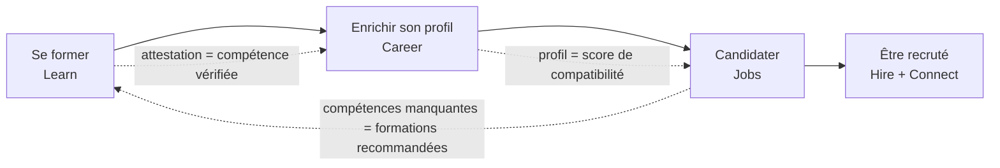

### 6.2 Visiteur : découvrir puis s'inscrire avec un forfait

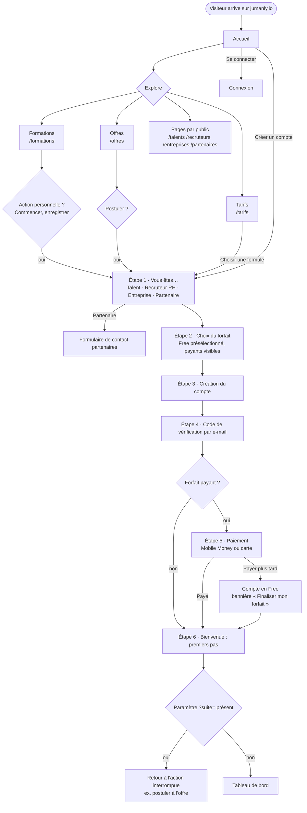

Règles :
- Le choix d'une formule sur `/tarifs` préremplit l'étape 1 et l'étape 2 (`/inscription?profil=talent&forfait=talent_pro`).
- Le paramètre `suite` n'accepte que des chemins internes (pas de redirection ouverte).
- Une entreprise qui choisit Company Premium est dirigée vers la demande de devis ; son compte démarre en RH Free.
- Un forfait payant non réglé ne bloque jamais l'accès : le compte fonctionne en Free.

### 6.3 Talent : de la candidature au recrutement

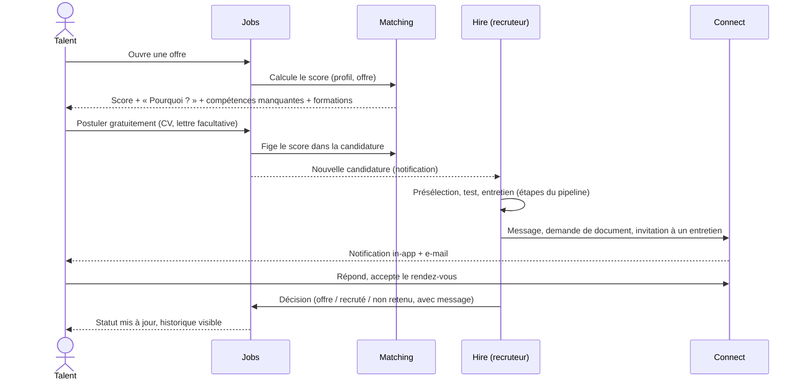

### 6.4 Recruteur RH : du compte à la première embauche

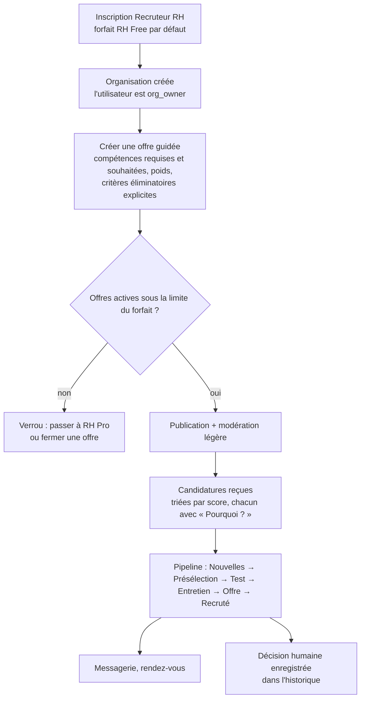

### 6.5 Entreprise : recruter à plusieurs

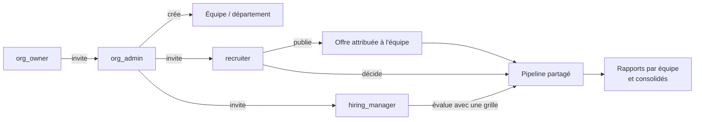

### 6.6 Paiement Mobile Money (prépayé)

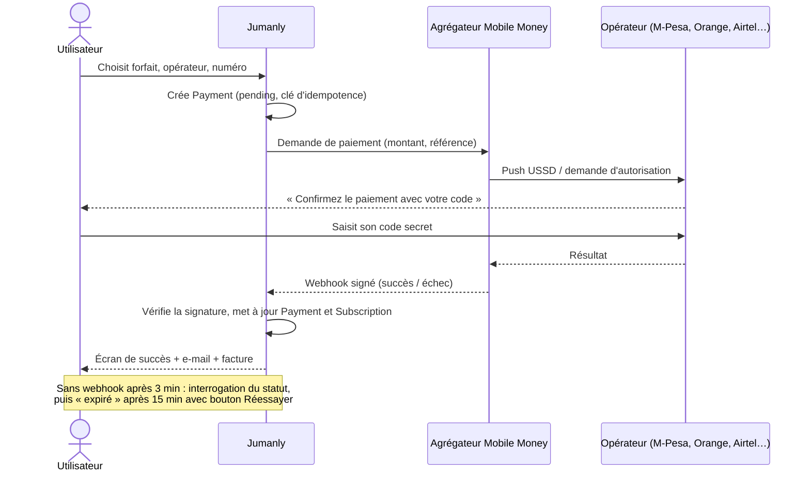

### 6.7 Cycle de vie d'un abonnement

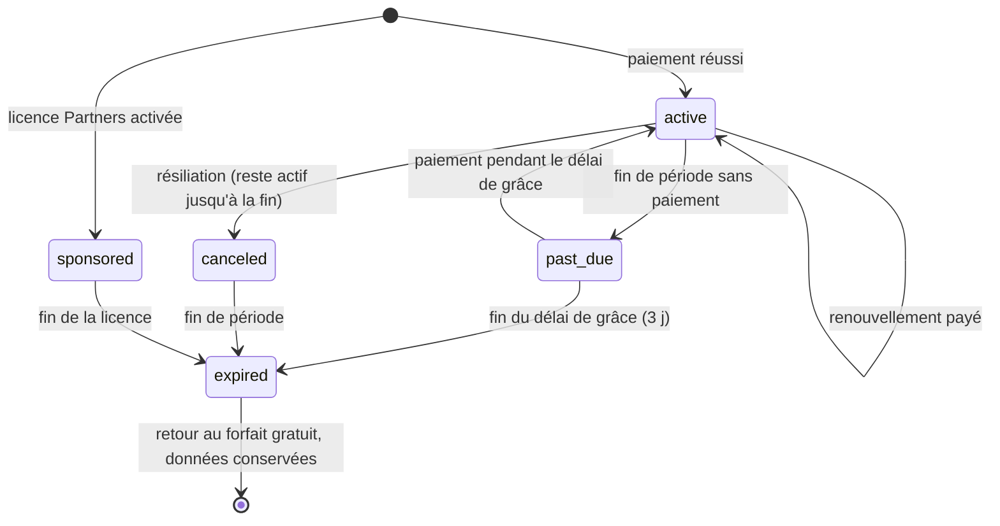

### 6.8 Partenaire : licences sponsorisées

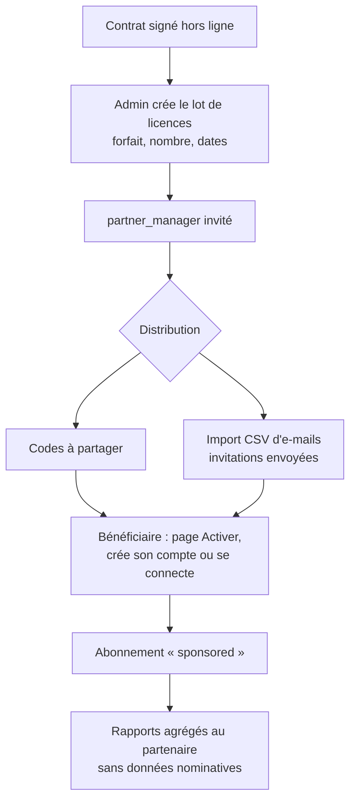

### 6.9 Learn : de la leçon à la compétence vérifiée

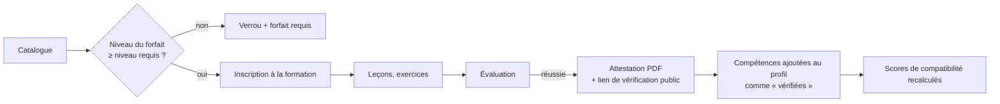

---

## Partie 07 · Écrans, routes et fonctionnalités

Les routes publiques sont en français (public francophone, référencement). L'espace connecté vit sous `/app`. Les textes de chaque écran sont dans `textes/textes-application.md` (un fichier unique, en 10 parties). Les maquettes de référence sont dans `maquettes-ui/` (desktop 1440 px, mobile 390 px).

Légende : **[E1]** = étape de la feuille de route où l'écran est livré (voir `12-feuille-de-route.md`).

### 1. Partie publique (sans connexion)

Objectif : un visiteur comprend ce qu'est Jumanly, voit **les formations, les offres d'emploi et les forfaits**, puis s'inscrit ou se connecte. Tout est indexable (SSR, métadonnées, sitemap).

| Route | Écran | Contenu clé | Étape |
|---|---|---|---|
| `/` | Accueil | Héros « Learn. Grow. Connect. », parcours en 4 étapes, 3 publics, modules, aperçu formations et offres, forfaits résumés, confiance (IA explicable, candidatures gratuites, confidentialité), FAQ courte, appel à l'inscription | E1 |
| `/a-propos` | À propos | Vision, mission, positionnement EdTech · CareerTech · HRTech, The Growth Lab, valeurs | E1 |
| `/talents` | Pour les talents | Learn, Career, Jobs, Connect ; formules Talents | E1 |
| `/recruteurs` | Pour les recruteurs | Hire, matching explicable, formules RH | E1 |
| `/entreprises` | Pour les entreprises | Collaboration, équipes, rapports ; formules Company ; demande de devis | E1 |
| `/partenaires` | Jumanly Partners | Licences sponsorisées, exemple chiffré, rapports agrégés, formulaire de contact | E1 |
| `/formations` | Catalogue public | Liste filtrable (thème, niveau, gratuit/inclus dans un forfait), cartes avec badge de forfait requis | E1 |
| `/formations/[slug]` | Fiche formation | Programme, durée, niveau, attestation, première leçon en aperçu, forfait requis, bouton « Commencer » (vers inscription si non connecté) | E1 |
| `/offres` | Offres publiques | Recherche (mot-clé, ville, pays, contrat, télétravail), cartes d'offres | E1 |
| `/offres/[slug]` | Détail d'offre public | Description, critères, entreprise (badge vérifiée), « Postuler gratuitement » (vers connexion puis retour sur l'offre) ; le score de compatibilité n'apparaît qu'une fois connecté | E1 |
| `/entreprises/[slug]` | Page entreprise publique | Présentation, offres ouvertes | E8 |
| `/tarifs` | Forfaits | Onglets Talents · RH · Companies · Partners, cartes de formules, comparatif, FAQ facturation | E1 |
| `/faq` | Questions fréquentes | Par thème | E1 |
| `/contact` | Contact | Formulaire (envoi par courriel), adresses e-mail. **Aucun téléphone.** | E1 |
| `/attestations/[code]` | Vérification publique d'une attestation | Nom, formation, date, statut valide ou révoquée | E5 |
| `/comment-fonctionne-le-matching` | Explication publique du matching | Critères, données jamais utilisées, droit de révision | E6 |
| `/portfolio/[slug]` | Portfolio public d'un talent (s'il le publie) | | E10 |
| `/mentions-legales`, `/confidentialite`, `/conditions`, `/cookies` | Pages légales | Gabarits à faire valider par un juriste | E1 |

Un visiteur non connecté peut tout parcourir. Les actions personnelles (postuler, commencer une formation, enregistrer) mènent à `/inscription` avec un paramètre `?suite=` qui ramène à l'action après inscription.

### 2. Authentification et inscription avec choix du forfait

| Route | Écran | Étape |
|---|---|---|
| `/connexion` | Connexion (e-mail + mot de passe, Google, lien magique) | E2 |
| `/mot-de-passe-oublie`, `/reinitialiser` | Récupération | E2 |
| `/inscription` | Étape 1 : « Vous êtes… » Talent · Recruteur ou consultant RH · Entreprise · Institution partenaire | E2 |
| `/inscription/forfait` | Étape 2 : choix du forfait de la famille (Free présélectionné, payants visibles, comparatif repliable) | E2 |
| `/inscription/compte` | Étape 3 : nom, e-mail, mot de passe, pays, ville, consentements ; pour RH/Entreprise : nom de l'organisation | E2 |
| `/inscription/verification` | Étape 4 : code envoyé par e-mail | E2 |
| `/inscription/paiement` | Étape 5 (si forfait payant) : Mobile Money ou carte ; lien « Commencer en Free et payer plus tard » | E7 (avant E7 : forfait payant activé en essai ou manuellement) |
| `/app/bienvenue` | Étape 6 : premiers pas (objectif, compétences, CV à importer ou à créer ; pour un recruteur : première offre) | E2 |
| `/activer` | Activation d'une licence Partners par code | E9 |

« Institution partenaire » ne crée pas de compte en libre-service : l'étape 1 renvoie vers le formulaire `/partenaires#contact`.

### 3. Espace talent (`/app`)

Navigation : barre latérale Sapin (desktop) ou pilule flottante (mobile) : Accueil · Learn · Career · Jobs · Messages. Profil et abonnement dans le menu du compte.

| Route | Écran (maquette) | Fonctions | Étape |
|---|---|---|---|
| `/app` | Tableau de bord talent (01) | Salutation, prochaine étape, progression formations, candidatures en cours, carte IA « offres compatibles » avec « Pourquoi ? », quotas | E3 |
| `/app/profil` | Profil professionnel | Identité, titre, résumé, expériences, formations, compétences (avec niveau et preuve), langues, disponibilité, préférences (contrat, lieu, télétravail, salaire), visibilité | E3 |
| `/app/learn` | Catalogue Learn (02) | Mes formations, catalogue filtré selon le forfait (verrous avec forfait requis) | E5 |
| `/app/learn/[slug]` | Lecteur (03) | Vidéo, supports, notes, quiz, progression, attestation | E5 |
| `/app/learn/attestations` | Attestations | Liste, téléchargement PDF, lien de vérification public | E5 |
| `/app/career` | Accueil Career | Diagnostic, documents, plan de progression | E3 |
| `/app/career/diagnostic` | Diagnostic de carrière | Questionnaire ; simplifié (règles) ou personnalisé (IA) | E3 / E6 |
| `/app/career/cv` | CV et coach IA (04) | Éditeur de CV par sections, modèles, export PDF, suggestions IA avec « Pourquoi ? » et Appliquer/Ignorer | E3 / E6 |
| `/app/career/documents` | Lettres, biographie, correction | Génération et correction IA | E10 |
| `/app/career/linkedin` | Préparation LinkedIn | Titre, résumé, compétences suggérés | E10 |
| `/app/career/entretiens` | Simulations d'entretien | Texte puis voix ; feedback structuré | E10 |
| `/app/career/plan` | Plan de progression | Objectifs, étapes, formations recommandées | E6 |
| `/app/career/portfolio` | Portfolio | Projets, médias, page publique partageable | E10 |
| `/app/jobs` | Recherche d'offres (05) | Filtres, compatibilité, enregistrer | E3 |
| `/app/jobs/[slug]` | Détail d'offre (06) | Score de compatibilité et « Pourquoi ? », compétences manquantes et formations pour les combler, postuler | E3 / E6 |
| `/app/jobs/candidatures` | Mes candidatures | Statut par étape, historique, messages | E3 |
| `/app/jobs/enregistrees` | Offres enregistrées | | E3 |
| `/app/messages` | Messagerie Connect (08) | Conversations liées aux candidatures, invitations, demandes de documents, rendez-vous | E4 |
| `/app/notifications` | Notifications | | E4 |
| `/app/abonnement` | Formules (09, à corriger) | Forfait actuel, quotas, changer de forfait, historique de paiements, factures | E2 / E7 |
| `/app/parametres` | Paramètres | Compte, sécurité, confidentialité, notifications, langue, export et suppression des données | E2 |

### 4. Espace recruteur et entreprise (`/app/hire`)

Un utilisateur qui appartient à une organisation voit un **sélecteur d'espace** (Personnel · nom de l'organisation). Le menu Hire apparaît pour l'espace organisation.

| Route | Écran | Fonctions | Étape |
|---|---|---|---|
| `/app/hire` | Tableau de bord recrutement | Offres actives, candidatures nouvelles, entretiens à venir, quotas | E4 |
| `/app/hire/offres` | Mes offres | Brouillons, publiées, fermées ; limite `jobs.active.max` | E4 |
| `/app/hire/offres/nouvelle` | Créer une offre | Formulaire guidé, compétences requises et souhaitées avec poids, critères éliminatoires explicites, aperçu | E4 |
| `/app/hire/offres/[id]` | Pipeline (07) | Colonnes par étape, glisser-déposer, matching explicable, filtres | E4 / E6 |
| `/app/hire/candidats/[applicationId]` | Fiche candidature | Profil, CV, analyse structurée, score et « Pourquoi ? », grille d'évaluation, notes, historique des décisions | E4 / E8 |
| `/app/hire/talents` | Recherche dans le vivier | Selon `hire.talent_search`, demande de mise en relation | E8 |
| `/app/hire/viviers` | Viviers et listes | Partagés selon le forfait | E8 |
| `/app/hire/entretiens` | Agenda des entretiens | Rendez-vous, invitations | E8 |
| `/app/hire/rapports` | Statistiques et rapports | Selon `reports.level`, export si autorisé | E8 |
| `/app/organisation` | Organisation | Profil entreprise, vérification, membres, invitations, équipes, départements, entités | E4 / E8 |
| `/app/organisation/abonnement` | Abonnement organisation | Forfait, sièges, quotas, paiements | E7 |

### 5. Espace partenaire (`/app/partenaire`)

| Route | Écran | Étape |
|---|---|---|
| `/app/partenaire` | Tableau de bord : licences achetées, activées, actives ; usage agrégé | E9 |
| `/app/partenaire/licences` | Lots, codes, liens d'invitation, import CSV d'e-mails | E9 |
| `/app/partenaire/rapports` | Rapports d'impact agrégés (formations suivies, attestations, candidatures, embauches déclarées), export PDF ; jamais de donnée nominative sans consentement | E9 |

### 6. Jumanly Admin (`/admin`)

| Route | Fonction | Étape |
|---|---|---|
| `/admin` | Indicateurs (note § 11) : utilisateurs gratuits et payants, conversion Free vers payant, revenu mensuel récurrent, renouvellement, coût IA, comptes entreprises actifs, revenus institutionnels | E2 puis enrichi |
| `/admin/utilisateurs` | Recherche, détail, suspension, rôles | E2 |
| `/admin/organisations` | Vérification des entreprises | E8 |
| `/admin/forfaits` | Forfaits, prix, droits et quotas modifiables sans redéploiement | E2 |
| `/admin/abonnements` | Abonnements, paiements, remboursements manuels | E7 |
| `/admin/formations` | Éditeur de formations : modules, leçons, vidéos, quiz, attestations | E5 |
| `/admin/offres` | Modération des offres | E4 |
| `/admin/partenaires` | Contrats, lots de licences | E9 |
| `/admin/ia` | Consommation IA par fonction et par forfait, poids du matching, journal d'audit | E6 |
| `/admin/contenus` | Textes éditables (FAQ, bannières) | E11 |
| `/admin/signalements` | Signalements d'offres et de messages | E4 |

### 7. Critères d'acceptation transverses

- Chaque écran fonctionne de 360 px à 1920 px de large ; mobile d'abord.
- Temps de chargement cible : page publique < 2,5 s (LCP) sur 3G rapide ; poids JS initial < 200 Ko compressés pour les pages publiques.
- Accessibilité WCAG 2.2 AA : contrastes (attention : texte blanc sur Lime interdit, texte Sapin sur Lime obligatoire), navigation clavier, libellés de formulaires, focus visible.
- Chaque état est prévu : chargement (squelettes), vide, erreur, quota atteint, droit manquant (verrou + forfait requis + bouton « Voir les forfaits »).
- Vocabulaire : « forfait » dans la navigation et les boutons (« Voir les forfaits ») ; « formule » est accepté comme synonyme dans les textes de présentation.
- E-mails : les modèles de la partie 07 de `textes/textes-application.md` (clés `mail.*`) font foi ; les clés `email.*` de la partie 02 et `*.email.*` de la partie 05 servent de variantes courtes ou d'aperçus. Toute adresse de support affichée est assistant@jumanly.io ; infojumanly@gmail.com est l'adresse générale (contact, pied de page).
- Les clés de texte suffixées `.text` sont la valeur d'un nœud qui a aussi des sous-clés (ex. `learn.mine.empty.text` et `learn.mine.empty.cta`).
- Tout texte vient des fichiers de traduction (`messages/fr.json`), aucun texte en dur dans les composants.
- Toute suggestion IA porte l'orbe IA, un lien « Pourquoi ? » et, si elle modifie quelque chose, des boutons Appliquer / Ignorer.

---

## Partie 08 · Matching IA explicable (Jumanly Intelligence)

> « Le moteur de matching assurera la correspondance entre les besoins des employeurs et les qualifications des utilisateurs, sans transformer automatiquement ces recommandations en décisions de recrutement. » (note conceptuelle, § 9)

### 8.1 Les cinq règles

1. **Le score est calculé, pas deviné.** Il résulte de critères mesurables et de poids connus. Le modèle de langage ne fixe jamais le score.
2. **Chaque score s'explique.** Un « Pourquoi ? » montre les critères remplis, partiels, manquants, et les données utilisées.
3. **L'humain décide.** Aucun rejet automatique, aucune candidature masquée. Le score aide à trier ; la décision est enregistrée avec son auteur.
4. **Certaines données ne sont jamais utilisées** : nom, genre, âge ou date de naissance, photo, nationalité et origine, religion, situation familiale, état de santé, handicap, adresse précise. Elles ne sont ni lues par le calcul ni envoyées au modèle d'IA pour le matching.
5. **On peut contester.** Le talent signale une erreur ou demande une révision humaine ; le recruteur peut ajuster les poids de son offre (selon forfait), dans des bornes.

### 8.2 Vue d'ensemble du calcul

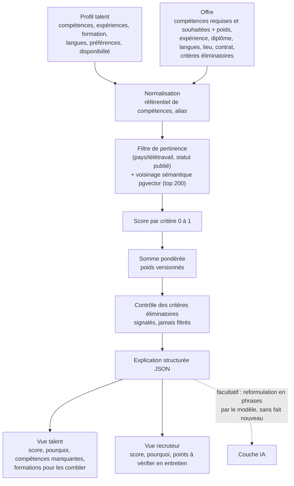

### 8.3 Critères et poids par défaut

Poids stockés dans `MatchingWeights` (versionnés, modifiables dans `/admin/ia`). Valeurs initiales :

| Critère (clé) | Poids | Mesure (0 à 1) |
|---|---|---|
| Compétences requises (`skills_required`) | 35 | Moyenne pondérée par `JobSkill.weight` de la couverture de chaque compétence requise |
| Compétences souhaitées (`skills_preferred`) | 10 | Idem pour les compétences souhaitées |
| Expérience (`experience`) | 15 | `min(1, années pertinentes / experienceMin)` ; 1 si aucun minimum |
| Formation (`education`) | 10 | 1 si niveau ≥ requis ; 0,6 si un niveau en dessous ; 0,3 sinon ; une attestation Jumanly liée au domaine ajoute 0,2 (plafond 1) ; 1 si rien n'est exigé |
| Langues (`languages`) | 10 | Pour chaque langue exigée : `min(1, niveau CECRL du talent / niveau exigé)`, moyenne |
| Lieu et mode de travail (`location`) | 10 | Télétravail : 1 ; même ville : 1 ; même pays et talent mobile : 0,7 ; autre : 0,3 |
| Contrat et disponibilité (`contract`) | 5 | 0,5 si le contrat fait partie des souhaits + 0,5 si la disponibilité est compatible avec la date de prise de poste |
| Proximité sémantique (`semantic`) | 5 | Similarité cosinus profil/offre ramenée sur 0 à 1 (0,2 → 0 ; 0,8 → 1) |

**Couverture d'une compétence** :

| Situation | Valeur |
|---|---|
| Compétence présente, niveau ≥ niveau minimum, **vérifiée** (attestation, évaluation) | 1,0 |
| Compétence présente, niveau ≥ minimum, **déclarée** | 0,9 |
| Compétence présente, niveau inférieur | `0,9 × niveau / niveau minimum` |
| Compétence proche (alias ou similarité sémantique ≥ 0,85 dans le référentiel) | 0,6 |
| Absente | 0 |

L'écart entre « vérifiée » et « déclarée » reste faible pour ne pas pénaliser un talent sans moyens : les formations et évaluations qui vérifient les compétences de base sont accessibles en Free.

**Information manquante** : si le talent n'a pas renseigné une donnée (ex. langues), le critère vaut 0,5, porte le statut `unknown` et l'explication propose de compléter le profil. On ne pénalise pas l'absence comme un échec.

**Formule** :

```
score = round( 100 × Σ (poids_c × valeur_c) / Σ poids_c )   pour les critères applicables
```

Un critère non applicable (l'offre n'exige aucune langue) est retiré du numérateur **et** du dénominateur.

**Bandes affichées** :

| Score | Bande | Couleur d'interface |
|---|---|---|
| 85 à 100 | Très compatible | Lime |
| 70 à 84 | Compatible | Menthe claire |
| 50 à 69 | Partiellement compatible | Ambre doux |
| 0 à 49 | Peu compatible | Brume (jamais rouge : ce n'est pas un échec) |

### 8.4 Critères éliminatoires

- Définis **explicitement** par le recruteur à la création de l'offre, choisis dans une liste fermée : langue obligatoire, diplôme exigé par la réglementation, autorisation de travail dans le pays, permis de conduire, présence sur site obligatoire.
- Ils ne retirent **pas** la candidature : ils apparaissent en tête de la fiche (« Critère éliminatoire non rempli : … ») et le talent est prévenu **avant** de postuler, avec la possibilité de postuler quand même.
- Les critères libres (« bonne présentation », « jeune », etc.) sont interdits par la validation du formulaire et la modération.

### 8.5 Explication structurée

Chaque calcul produit un objet stocké dans `MatchResult.explanation` :

```json
{
  "score": 82,
  "band": "compatible",
  "weightsVersion": "2026-10-v1",
  "computedAt": "2026-10-13T10:00:00Z",
  "criteria": [
    {
      "key": "skills_required",
      "weight": 35,
      "value": 0.86,
      "status": "partial",
      "evidence": [
        { "skill": "SQL", "required": 3, "talent": 3, "verified": true, "source": "certificate:JM-LRN-0042" },
        { "skill": "Power BI", "required": 3, "talent": 2, "verified": false, "source": "declared" }
      ],
      "tip": { "type": "course", "courseSlug": "power-bi-niveau-2" }
    },
    { "key": "languages", "weight": 10, "value": 0.5, "status": "unknown", "tip": { "type": "complete_profile", "section": "languages" } }
  ],
  "missingSkills": [
    { "skill": "Python", "importance": "preferred", "courses": ["python-pour-l-analyse"] }
  ],
  "knockouts": [ { "key": "language", "label": "Anglais B2", "met": true } ],
  "notUsed": ["name", "gender", "age", "photo", "nationality", "religion", "marital_status", "health", "address"]
}
```

Le texte affiché est produit **à partir de ces faits** par des gabarits de phrases (`textes/textes-application.md (partie 06)`). En option (forfaits avec `hire.matching.level = explainable` ou talents Pro et plus), le modèle d'IA reformule l'explication en phrases naturelles, avec cette consigne système : n'utiliser que les faits fournis, ne rien ajouter, ne jamais conseiller de rejeter. Si la réponse du modèle est invalide (contrôle Zod) ou cite un fait absent, on affiche le gabarit.

### 8.6 Ce que voit chacun

| | Talent (tous forfaits) | RH Pro (`suggestions`) | RH Premium, Company et plus (`explainable`) |
|---|---|---|---|
| Score et bande sur les offres | ✓ | | |
| « Pourquoi ? » détaillé et compétences manquantes | ✓ | | |
| Formations recommandées pour combler l'écart | ✓ (verrou si la formation dépasse le forfait) | | |
| Score et bande sur chaque candidature | | ✓ | ✓ |
| Trois raisons principales | | ✓ | ✓ |
| Détail complet par critère et preuves | | | ✓ |
| « Points à vérifier en entretien » | | | ✓ |
| Suggestions de talents du vivier | | ✓ | ✓ (avec explication) |
| Ajustement des poids pour une offre (± 50 % par critère, dans des bornes) | | | ✓ |

RH Free n'a pas de matching (doc 05) : les candidatures sont listées par date. **Choix proposé, à valider** : le score et le « Pourquoi ? » sont montrés à **tous les talents**, y compris Free, car le calcul ne coûte presque rien (aucun appel au modèle) et sert l'inclusion. La reformulation par l'IA et l'adaptation du CV à l'offre restent réservées aux forfaits qui les incluent.

### 8.7 Recommandations

| Recommandation | Calcul |
|---|---|
| Offres pour un talent | Offres publiées filtrées par préférences (pays, télétravail, contrat), puis top 200 par voisinage sémantique, puis score exact ; on affiche les meilleures avec leur « Pourquoi ? » |
| Formations pour un talent | Compétences manquantes les plus fréquentes dans ses 20 offres les plus compatibles, croisées avec `CourseSkill` ; priorité aux formations accessibles avec son forfait |
| Talents pour une offre | Profils `visibility = recruiters` ou `anonymous` uniquement, même méthode ; les profils anonymes restent masqués jusqu'à l'acceptation d'une mise en relation |

### 8.8 Pseudocode de référence

```ts
// src/server/matching/score.ts
export function scoreMatch(profile: NormalizedProfile, job: NormalizedJob, w: Weights): MatchExplanation {
  const criteria: CriterionResult[] = [];

  criteria.push(skillsCriterion("skills_required", profile, job.skills.filter(s => s.importance === "required"), w));
  criteria.push(skillsCriterion("skills_preferred", profile, job.skills.filter(s => s.importance === "preferred"), w));
  criteria.push(experienceCriterion(profile, job, w));
  criteria.push(educationCriterion(profile, job, w));
  criteria.push(languagesCriterion(profile, job, w));
  criteria.push(locationCriterion(profile, job, w));
  criteria.push(contractCriterion(profile, job, w));
  criteria.push(semanticCriterion(profile.embedding, job.embedding, w));

  const applicable = criteria.filter(c => c.status !== "not_applicable");
  const total = applicable.reduce((a, c) => a + c.weight, 0);
  const score = Math.round((100 * applicable.reduce((a, c) => a + c.weight * c.value, 0)) / total);

  return {
    score,
    band: bandFor(score),
    criteria,
    missingSkills: missingSkills(profile, job),          // + formations via CourseSkill
    knockouts: evaluateKnockouts(profile, job.knockoutCriteria),
    notUsed: EXCLUDED_ATTRIBUTES,
    weightsVersion: w.version,
    computedAt: new Date().toISOString(),
  };
}
```

`NormalizedProfile` est construit par une fonction qui **ne copie pas** les champs exclus (liste blanche de champs). Un test vérifie que modifier nom, genre, âge ou photo d'un profil ne change pas le score (test contrefactuel).

### 8.9 Rôle du modèle d'IA dans Intelligence

| Fonction | Rôle du modèle | Garde-fous |
|---|---|---|
| Analyse de CV (`cv_parse`) | Extraire expériences, formations, compétences en JSON | Le talent valide chaque élément avant qu'il entre dans son profil |
| Coach CV (`cv_coach`) | Proposer des reformulations section par section | Appliquer / Ignorer, « Pourquoi ? » obligatoire, aucune invention d'expérience |
| Adapter le CV à une offre (`cv_tailor`) | Réordonner et reformuler selon l'offre | Ne jamais ajouter une compétence que le talent n'a pas |
| Diagnostic personnalisé (`diagnostic`) | Synthèse et pistes à partir du questionnaire | Résultat expliqué, plan modifiable |
| Simulations d'entretien (`interview`) | Questions et retour structuré | Retour sur le fond et la forme, pas de note « embauchable » |
| Analyse structurée pour le recruteur (`hire_cv_analysis`) | Résumé factuel du CV par rapport à l'offre | Faits sourcés, pas d'avis sur la personne |
| Reformulation des explications (`match_explain`) | Phrases à partir du JSON | Faits fournis uniquement |

Chaque appel : vérifie le consentement IA de l'utilisateur, le droit, le quota (`ai.credits.monthly`), journalise dans `AiUsage`, et renvoie une sortie validée par Zod.

### 8.10 Contrôle, audit et amélioration

- Historique des décisions (`ApplicationEvent`) : on sait qui a décidé quoi et quand, et quel score était affiché à ce moment.
- Tableau `/admin/ia` : distribution des scores, taux d'utilisation du « Pourquoi ? », signalements d'erreurs, coût par fonction.
- Revue trimestrielle des poids ; toute nouvelle version de poids est datée et réversible.
- Tests automatiques : contrefactuels (attributs exclus), monotonie (ajouter une compétence requise ne peut pas faire baisser le score), bornes (0 à 100), critère non applicable bien retiré.

---

## Partie 09 · Paiements : Mobile Money et carte

La note prévoit des paiements « adaptés aux usages locaux, notamment par carte bancaire et Mobile Money lorsque des intégrations fiables seront disponibles ». Prix affichés et facturés en **USD**.

### 9.1 Principe : une interface, plusieurs adaptateurs

```ts
// src/server/payments/types.ts
interface PaymentProvider {
  id: string;                                   // "mobile_money_x", "card_y", "fake"
  methods: ("mobile_money" | "card")[];
  countries: string[];                          // codes ISO couverts
  operators?: string[];                         // "mpesa", "orange", "airtel", "mtn"…
  createPayment(input: {
    amountCents: number; currency: "USD"; reference: string;
    customer: { email: string; msisdn?: string; operator?: string; country: string };
    returnUrl: string; idempotencyKey: string;
  }): Promise<{ status: "pending" | "redirect"; providerRef: string; redirectUrl?: string }>;
  getStatus(providerRef: string): Promise<"pending" | "succeeded" | "failed" | "expired">;
  verifyWebhook(headers: Headers, rawBody: string): Promise<WebhookEvent>;
  refund?(providerRef: string, amountCents?: number): Promise<void>;
}
```

- Un adaptateur **`fake`** est livré à l'étape E2 : il simule succès, échec, attente et expiration, pour développer tout le parcours avant de signer avec un fournisseur.
- Le fournisseur réel est choisi pendant la phase de test, selon : pays couverts (RDC en priorité, puis Afrique centrale et de l'Ouest), opérateurs (M-Pesa, Orange Money, Airtel Money, MTN MoMo…), prise en charge de l'USD, frais, délais de reversement, qualité des webhooks, conformité. **Candidats à évaluer** (couverture à vérifier au moment du choix, elle évolue) : agrégateurs panafricains de Mobile Money et passerelles locales de la RDC. Pour la carte : une passerelle internationale acceptant les cartes émises en Afrique.
- Le choix est consigné dans `docs/decisions/` avant l'étape E7.

### 9.2 Règles

| Règle | Détail |
|---|---|
| Abonnement prépayé | Mobile Money ne permet généralement pas le prélèvement automatique : chaque période se paie. La carte peut être récurrente si le fournisseur le permet ; même modèle de données. |
| Rappels | J-7, J-3, J-0 par notification et e-mail, avec lien de paiement direct |
| Délai de grâce | 3 jours (provisoire, réglable) en statut `past_due`, accès conservé |
| Fin de grâce | Retour au forfait gratuit de la famille, **aucune donnée supprimée** ; contenus au-delà des limites gelés (ex. offres actives en trop passées en brouillon, au choix du recruteur) |
| Idempotence | Une clé par tentative ; un webhook rejoué n'active jamais deux fois |
| Source de vérité | Le webhook signé, ou l'interrogation `getStatus` ; jamais le retour navigateur seul |
| Expiration | Paiement Mobile Money sans réponse : interrogation à 3 min, expiration à 15 min, bouton « Réessayer » |
| Montée en gamme | Effet immédiat ; le crédit du temps restant sur l'ancien forfait est déduit (règle de prorata à valider dans les conditions commerciales) |
| Réduction de gamme | Effet en fin de période (`pendingPlanId`) |
| Factures | Numérotation séquentielle, PDF, mention The Growth Lab ; mentions légales et fiscales **à compléter** par l'équipe |
| Remboursements | Manuels depuis l'admin à l'étape E7 ; politique à définir dans les CGV |
| Devises locales | Prix en USD ; si le fournisseur convertit, afficher le montant estimé en monnaie locale **avant** confirmation, avec la mention « montant indicatif » |
| Sécurité | Numéro de téléphone stocké masqué ; aucune donnée de carte ne transite par Jumanly (champs hébergés par le fournisseur) |

### 9.3 Écran de paiement (résumé)

1. Récapitulatif : forfait, prix USD/mois, période couverte.
2. Choix de la méthode : Mobile Money (opérateur + numéro) ou carte.
3. Mobile Money : « Validez le paiement sur votre téléphone » avec minuteur et instructions par opérateur ; carte : champs hébergés.
4. Succès : forfait actif, quotas mis à jour, facture envoyée par e-mail.
5. Échec ou expiration : message clair, bouton Réessayer, lien « Continuer en Free ».

Les textes complets sont dans `textes/textes-application.md (partie 05)`.

### 9.4 Webhooks

Route `POST /api/webhooks/payments/[provider]` : lecture du corps brut, vérification de signature, enregistrement de l'événement (table `PaymentEvent` avec identifiant unique du fournisseur), traitement dans une tâche de fond idempotente, réponse 200 rapide.

---

## Partie 10 · Sécurité, confidentialité et conformité

### 10.1 Authentification et sessions

- Mots de passe : 10 caractères minimum, vérification contre les mots de passe divulgués (k-anonymat), hachage Argon2id ou scrypt (géré par Better Auth).
- Vérification de l'e-mail par code à 6 chiffres, valable 15 minutes, 5 essais.
- Connexion Google et lien magique en option.
- Sessions en cookie `httpOnly`, `secure`, `SameSite=Lax` ; expiration 30 jours glissants ; liste des sessions et déconnexion à distance dans les paramètres.
- Double authentification (TOTP) proposée aux comptes organisation et **obligatoire** pour `platform_admin`.
- Limitation de débit (Redis) : connexion, inscription, mot de passe oublié, formulaire de contact, envoi de messages, recherche de talents.

### 10.2 Autorisation

- Chaque Server Action et route API commence par une garde : session, rôle, appartenance à l'organisation de l'espace actif, droit du forfait, quota.
- Isolation stricte par `organizationId` pour toutes les données Hire ; tests automatiques qui tentent d'accéder aux données d'une autre organisation.
- Un recruteur ne voit un profil complet que si le talent a candidaté à l'une de ses offres ou a rendu son profil visible ; chaque consultation de profil est journalisée (`AuditLog`).
- Les partenaires ne reçoivent que des agrégats, avec un **seuil minimal de 10 personnes** par cellule de rapport (en dessous, la valeur est masquée) pour éviter la réidentification.

### 10.3 Protection contre l'extraction massive

- Quotas de recherche et de mise en relation (doc 05).
- Pagination plafonnée, pas d'export de profils de talents.
- Détection d'usage anormal (volume de consultations) avec alerte admin et blocage temporaire.

### 10.4 Fichiers

- Téléversement direct vers le stockage par URL signée ; types autorisés : PDF, DOCX, PNG, JPG, WEBP ; 10 Mo maximum (CV), 2 Mo (photos).
- Analyse antivirus des fichiers (service ou ClamAV) avant mise à disposition.
- Accès aux fichiers privés par URL signée de courte durée (5 minutes).

### 10.5 Sécurité applicative

- En-têtes : CSP stricte, HSTS, `X-Content-Type-Options`, `Referrer-Policy`, `Permissions-Policy` (micro autorisé seulement sur la page de simulation vocale).
- Protection CSRF (Server Actions de Next.js + vérification d'origine), échappement systématique, aucun HTML utilisateur non nettoyé (descriptions d'offres en Markdown nettoyé).
- Secrets uniquement en variables d'environnement ; `.env` jamais versionné ; analyse des dépendances (Dependabot) et des secrets dans la CI.
- Webhooks signés et idempotents.
- Sauvegardes quotidiennes de la base, conservation 30 jours, test de restauration mensuel.

### 10.6 Données personnelles

Les pays du public visé ont des lois de protection des données (par exemple en RDC, au Sénégal, en Côte d'Ivoire, au Cameroun) ; le RGPD s'applique aux utilisateurs situés dans l'Union européenne. **Le cadre exact est à faire valider par un juriste.** En pratique, l'application doit permettre dès le départ :

- consentements distincts et horodatés : conditions d'utilisation (obligatoire), usage de l'IA sur ses documents (obligatoire pour les fonctions IA, refusable), e-mails non essentiels (facultatif) ;
- réglage de visibilité du profil (`private`, `recruiters`, `anonymous`), `private` par défaut **à valider** (proposition : `recruiters` avec explication claire à l'inscription, car c'est ce qui permet d'être trouvé) ;
- export de ses données et suppression de son compte en libre-service ;
- information sur le matching : page « Comment fonctionne le matching », droit d'explication et de révision humaine ;
- registre des sous-traitants (hébergeur, e-mails, IA, paiements, vidéo) dans la politique de confidentialité ;
- les données envoyées au fournisseur d'IA ne servent pas à entraîner ses modèles (vérifier les conditions du contrat API).

### 10.7 Modération

- Offres : contrôle automatique (critères discriminatoires, demandes d'argent aux candidats, coordonnées hors plateforme) puis file de modération admin.
- Signalement d'offre, de message ou de profil ; blocage d'un interlocuteur dans la messagerie.
- Règle publiée : aucun recruteur ne peut demander de paiement à un candidat.

---

## Partie 11 · Design system de l'application

Référence visuelle : `identite-visuelle/charte-graphique.pdf`, `identite-visuelle/jumanly-tokens.css`, `maquettes-ui/jumanly-maquettes-ui.pdf` (planches 2 à 6 : principes, couleurs, typographie, composants, modules et IA ; planches 7 à 15 : écrans). Copier `jumanly-tokens.css` dans `src/styles/tokens.css` et le brancher sur Tailwind.

### 11.1 Couleurs

| Jeton | Valeur | Usage |
|---|---|---|
| `--jm-sapin` | #0F3F37 | Couleur de base : texte principal, barre latérale, boutons secondaires |
| `--jm-lime` | #A6F26B | Signature : bouton principal, élément actif, accents. **Texte toujours Sapin sur Lime**, jamais blanc |
| `--jm-creme` | #F2EDE5 | Fond de l'application et du site |
| `--jm-blanc` | #FFFFFF | Cartes, surfaces |
| `--jm-feuille` | #3DA14F | Succès, secondaire |
| `--jm-menthe` | #2FD3A6 | Module Intelligence (IA) uniquement |
| `--jm-nuit` | #0B1A1F | Fonds sombres |
| `--jm-neon` | #E3F67C | Labels sur fond sombre, badge « Nouveau » |
| `--jm-ardoise` | #5B6B68 | Texte secondaire |
| `--jm-brume` | #DCE5E1 | Bordures, séparateurs, bande « Peu compatible » |
| Ambre | #F2B33D | Alerte douce (quota à 80 %, délai de grâce) |
| Corail | #E25C4B | Erreur, baisse (jamais pour un score de candidat) |
| Menthe claire | #BFEFDF | Teinte de carte (module Jobs, bande « Compatible ») |

Teintes de cartes des modules : Learn = Lime, Career = Néon, Jobs = Menthe claire, Hire = Brume, Connect = Blanc, Intelligence = dégradé IA.

Dégradés (`--jm-degrade-signature`, `--jm-degrade-ia`, `--jm-degrade-profondeur`, `--jm-orbe-ia`) : voir le fichier de jetons. Prévoir une couleur unie de repli sous chaque dégradé.

### 11.2 Typographie

Une seule famille : **Sora** (300 à 700), chargée avec `next/font`.

| Style | Valeur | Usage |
|---|---|---|
| Display | 600 56/60 (mobile 36/40) | Héros du site public |
| H1 | 600 36/42 (mobile 28/34) | Titre de page |
| H2 | 500 24/30 | Titre de section, de carte |
| Body | 400 16/26 | Texte courant (jamais moins de 14 px sur mobile) |
| Label | 500 13/18, lettres espacées en capitales pour les surtitres | Libellés, badges |
| Caption | 300 12/18 | Mentions |

### 11.3 Formes, espacements, ombres

- Rayons : cartes 24 à 28 px, composants 18 px, petits éléments 12 px, boutons et badges en **pilule**.
- Grille d'espacement de 4 px ; marges de page 16 px (mobile), 32 px (tablette), 48 px (desktop).
- Ombres quasi nulles ; la hiérarchie vient des fonds (Crème → Blanc → teinte de module). Élément sélectionné : bordure 2 px Sapin.

### 11.4 Structure d'écran

- **Desktop (espace connecté)** : barre latérale Sapin de 92 px avec icônes et libellés, élément actif sur fond Lime ; panneau principal Crème à coins arrondis de 32 px.
- **Mobile** : en-tête Sapin, feuille Crème qui remonte, **navigation flottante en pilule** en bas (Accueil, Learn, Career, Jobs, Messages), élément actif Lime.
- **Site public** : en-tête clair (logo horizontal, liens, « Se connecter » en tertiaire, « Créer un compte » en principal), sections alternant Crème, Blanc et Sapin, pied de page Sapin avec contacts e-mail.

### 11.5 Composants (bibliothèque `src/components/ui`)

Boutons (principal Lime, secondaire Sapin, tertiaire contour, petit, icône ronde), champ de recherche en pilule, champs de formulaire, sélecteurs, cases, interrupteur, onglets soulignés, filtres en pilule, badges (score, « Nouveau », module, « Vérifiée », contrat, tendance + / −), barre de progression, anneau de progression, avatars et pile d'avatars, carte de statistique, carte de formation, carte d'offre, carte IA, étapes de pipeline, notification (toast Sapin), modale, tiroir mobile, tableau, squelettes de chargement, état vide illustré, verrou de forfait, jauge de quota, carte de formule.

Chaque composant : variantes typées, états (survol, focus visible, désactivé, chargement), accessible au clavier, documenté dans une page `/dev/composants` (visible seulement en local et preview).

### 11.6 L'IA dans l'interface

- **Orbe lumineux** (`--jm-orbe-ia`) : signale une proposition de l'IA, jamais utilisé ailleurs.
- **Dégradé IA** : fond des cartes de recommandation, du coach CV et du score de compatibilité.
- **« Pourquoi ? »** : lien avec icône œil sur chaque score ou suggestion ; ouvre un panneau d'explication (doc 08).
- **Contrôle humain** : boutons Appliquer / Ignorer ; rien ne change sans accord.

### 11.7 Ressources de marque fournies dans `ressources/`

Tout est fourni dans le dossier `ressources/` (détail dans `ressources/LISEZMOI.md`) :

- `jumanly-tokens.css` : jetons de design ;
- `logos/` : logos SVG et favicons ;
- `icones/` : les 41 icônes de la marque en trois styles (`trait`, `trait-blanc`, `duo`), plus un sprite SVG ;
- `illustrations/` : les personnages illustrés un par un, fond transparent, en SVG et PNG : Amani, Kofi, Nadia, M. Diallo, Fatou (6 poses chacun) et Orbi, l'assistant IA (réservé aux fonctions d'IA) ;
- `motifs/`, `formes/`, `fonds/` : éléments graphiques pour les sections du site public.

Usage des personnages : `salut` pour l'accueil et la bienvenue, `joie` pour les succès, `perplexe` pour les erreurs et les pages introuvables, `telephone` et `montre` pour présenter l'application, `repos` pour les états vides.

### 11.8 Accessibilité

WCAG 2.2 AA : contrastes vérifiés (Lime sur Crème insuffisant pour du texte : réserver le Lime aux fonds de boutons et aux pastilles), cibles tactiles de 44 px, focus visible Sapin 2 px + halo Lime, `prefers-reduced-motion` respecté, textes alternatifs, formulaires étiquetés, annonces `aria-live` pour les toasts et les résultats de paiement.

---

## Partie 12 · Feuille de route par étapes

Douze étapes, de E0 à E11. Chaque étape livre une application **qui fonctionne** et qu'on peut montrer. On ne commence une étape que lorsque la précédente respecte sa « définition de fini ». Chaque étape se termine par une PR relue et fusionnée, et une mise à jour de `docs/journal.md` (ce qui a été fait, décisions, dettes).

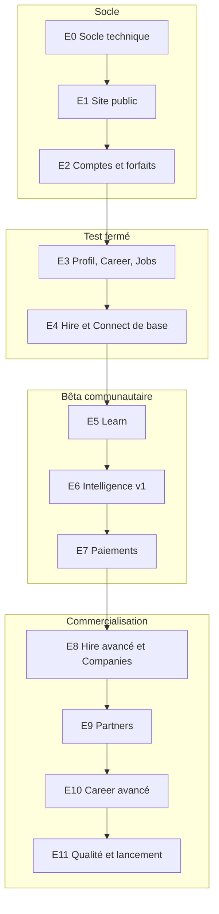

Chaque bloc correspond à une phase de lancement de la note conceptuelle (§ 12).

| Étape | Résultat visible | Phase de lancement |
|---|---|---|
| E0 | Projet qui démarre, design system, CI | |
| E1 | Site public complet, navigable sans compte | |
| E2 | Inscription avec choix du forfait, connexion, moteur de droits, admin des forfaits | |
| E3 | Profil talent, CV, diagnostic simple, recherche d'offres, candidature gratuite | |
| E4 | Recruteur : offres, pipeline, messagerie, notifications | **Test fermé** (10 talents, 2 à 3 recruteurs, 20 jours) |
| E5 | Formations, lecteur, quiz, attestations | |
| E6 | Matching explicable, coach CV, analyse de CV, quotas IA | |
| E7 | Paiement Mobile Money et carte, abonnements, factures | **Bêta** (50 talents, 5 à 10 employeurs, 30 jours) |
| E8 | Équipes, permissions, grilles, viviers, entretiens, rapports, entreprise vérifiée | **Commercialisation** |
| E9 | Licences sponsorisées, espace partenaire, rapports agrégés | **Déploiement institutionnel** |
| E10 | Lettres, LinkedIn, simulations d'entretien texte et voix, portfolio | |
| E11 | Performance, PWA, accessibilité, SEO, observabilité, contenus | |

---

### E0 · Socle technique

**Objectif** : un projet propre sur lequel tout le reste se construit.

**Périmètre** : Next.js + TypeScript strict, Tailwind branché sur `ressources/jumanly-tokens.css`, police Sora, ESLint/Prettier, Prisma + PostgreSQL (Docker Compose en local), next-intl avec `messages/fr.json` **généré à partir de `textes/`** (script `scripts/build-messages.ts` qui lit les tableaux `| Clé | Texte |`), bibliothèque de composants de base (doc 11, § 11.5) et page `/dev/composants`, gabarits de mise en page (site public, espace connecté desktop et mobile), Vitest + Playwright, GitHub Actions, `.env.example`, `docs/journal.md`, `docs/decisions/`.

**Définition de fini** : `pnpm dev` démarre ; `pnpm lint`, `pnpm typecheck`, `pnpm test`, `pnpm build` passent en CI ; la page `/dev/composants` montre tous les composants avec leurs états ; aucun texte en dur.

**Prompt à coller dans Claude Code** :
> Lis CLAUDE.md puis docs/specifications.md (partie 02), docs/specifications.md (partie 03) et docs/specifications.md (partie 11). Réalise l'étape E0 décrite dans docs/specifications.md (partie 12). Commence par me proposer ton plan en 10 lignes maximum, puis exécute-le. Écris le script qui convertit le fichier textes/textes-application.md en messages/fr.json. Termine en vérifiant la définition de fini et en mettant à jour docs/journal.md.

---

### E1 · Site public

**Objectif** : un visiteur comprend Jumanly et voit formations, offres et forfaits sans se connecter.

**Périmètre** : toutes les routes du doc 07 § 1 ; en-tête et pied de page publics ; formations et offres lues en base (seed de démonstration) avec recherche et filtres ; page `/tarifs` avec onglets et comparatifs lus depuis la table `Plan` (seed `plans.ts` créé dès cette étape) ; formulaire de contact envoyé par e-mail (adaptateur e-mail factice en local) ; métadonnées SEO, Open Graph, `sitemap.xml`, `robots.txt` ; bandeau cookies ; pages légales en gabarit.

**Définition de fini** : toutes les pages sont rendues côté serveur ; Lighthouse mobile ≥ 90 en performance, accessibilité, SEO sur `/`, `/formations`, `/offres`, `/tarifs` ; chaque bouton « Postuler », « Commencer » ou « Choisir » mène à `/inscription` avec les bons paramètres ; aucun numéro de téléphone nulle part.

**Prompt** :
> Réalise l'étape E1 (docs/specifications.md (partie 12)). Les pages sont listées dans docs/specifications.md (partie 07) § 1, les textes dans textes/textes-application.md (parties 01 et 05), les forfaits dans docs/specifications.md (partie 05). Crée le seed des forfaits avec toute la matrice de droits, et un seed de démonstration manifestement fictif. Respecte le design system (docs/specifications.md (partie 11)) et les maquettes de référence. Vérifie la définition de fini.

---

### E2 · Comptes, inscription avec forfaits, moteur de droits

**Objectif** : on s'inscrit en choisissant son profil et son forfait ; les droits s'appliquent partout.

**Périmètre** : Better Auth (e-mail + mot de passe, code de vérification, Google, lien magique), inscription en 6 étapes (doc 07 § 2, doc 06 § 6.2) avec `?profil=`, `?forfait=` et `?suite=` ; création automatique d'une organisation pour un recruteur ou une entreprise ; moteur de droits `can / level / limit / usage / consume` (doc 03 § 3.3) avec cache ; composant « verrou de forfait » et « jauge de quota » ; adaptateur de paiement **factice** pour tester les forfaits payants ; `/app/abonnement` (forfait actuel et quotas), `/app/parametres` (compte, sécurité, confidentialité, export et suppression) ; `/admin` minimal : utilisateurs, **forfaits et droits modifiables sans redéploiement** ; écran de bienvenue.

**Définition de fini** : tests unitaires du moteur de droits (chaque forfait du doc 05) ; test e2e « visiteur → choisit Pro sur /tarifs → s'inscrit → paie (factice) → arrive sur le tableau de bord avec Pro actif » ; test e2e « paie plus tard → compte Free » ; modifier un quota dans l'admin change le comportement sans redémarrage.

**Prompt** :
> Réalise l'étape E2. Sources : docs/specifications.md (partie 05) (forfaits, droits, rôles), docs/specifications.md (partie 06) § 6.2 et 6.7, docs/specifications.md (partie 07) § 2, docs/specifications.md (partie 03) § 3.3, docs/specifications.md (partie 09) § 9.1 (adaptateur factice), docs/specifications.md (partie 10) § 10.1, textes/textes-application.md (parties 02 et 05). Le code ne doit jamais tester un nom de forfait : uniquement des clés de droits. Écris les tests demandés dans la définition de fini.

---

### E3 · Profil talent, Career de base, Jobs

**Objectif** : un talent construit son profil et postule gratuitement.

**Périmètre** : `/app` (tableau de bord), `/app/profil` (sections, visibilité), référentiel de compétences (seed), `/app/career` (accueil), diagnostic **simplifié** sans IA (règles), éditeur de CV par sections avec 1 modèle (Free) et plusieurs modèles selon droit, export PDF ; `/app/jobs` (recherche, filtres, enregistrer), détail d'offre, **postuler** (CV + lettre facultative), `/app/jobs/candidatures` avec statuts ; reprise de l'action après inscription (`?suite=`).

**Définition de fini** : un talent Free peut créer son profil, générer un CV PDF, postuler à une offre et suivre sa candidature ; la candidature n'est jamais bloquée par un quota ou un forfait (test dédié).

**Prompt** :
> Réalise l'étape E3. Sources : docs/specifications.md (partie 07) § 3, docs/specifications.md (partie 04) (tables profil, Job, Application), docs/specifications.md (partie 06) § 6.3, textes/textes-application.md (partie 03). Le matching n'existe pas encore : prévois l'emplacement du score sur le détail d'offre sans l'afficher. Écris le test qui garantit que postuler reste possible quel que soit le forfait.

---

### E4 · Hire et Connect de base (prêt pour le test fermé)

**Objectif** : un recruteur RH Free publie une offre, reçoit des candidatures, échange et décide.

**Périmètre** : `/app/hire` (tableau de bord), création d'offre guidée (compétences requises/souhaitées avec poids, critères éliminatoires en liste fermée), limite d'offres actives, pipeline avec étapes par défaut et glisser-déposer, fiche candidature, historique des décisions (`ApplicationEvent`), message de refus bienveillant ; messagerie liée aux candidatures, demandes de documents ; notifications in-app et e-mails (Resend, modèles React Email) ; sélecteur d'espace Personnel / Organisation ; invitations de membres selon `org.seats` ; modération des offres et signalements dans l'admin ; isolation par organisation.

**Définition de fini** : test e2e complet « recruteur publie → talent postule → recruteur fait avancer → message → décision → talent voit le statut » ; test d'isolation entre deux organisations ; e-mails visibles en local (aperçu React Email).

**Après E4** : déployer sur `staging`, lancer le **test fermé** (10 talents, 2 à 3 recruteurs, 20 jours), recueillir les retours dans `docs/retours-test-ferme.md`.

**Prompt** :
> Réalise l'étape E4. Sources : docs/specifications.md (partie 07) § 4, docs/specifications.md (partie 04) (Organization, Membership, Job, PipelineStage, Application, ApplicationEvent, Conversation, Message, Notification), docs/specifications.md (partie 06) § 6.3 à 6.5, docs/specifications.md (partie 10) § 10.2 et 10.7, textes/textes-application.md (parties 04 et 07). Priorité à l'isolation des données entre organisations : écris d'abord les tests qui doivent échouer.

---

### E5 · Learn

**Objectif** : se former, être évalué, obtenir une attestation qui enrichit le profil.

**Périmètre** : catalogue connecté avec verrous selon `learn.catalog.level`, lecteur (vidéo HLS via l'adaptateur vidéo, supports, notes, questions), quiz, progression, attestation PDF avec page publique de vérification, compétences ajoutées au profil comme vérifiées ; éditeur de formations dans `/admin/formations` (rôle `content_editor`) ; leçons en aperçu visibles sur le site public.

**Définition de fini** : un éditeur crée une formation complète dans l'admin ; un talent Free suit une formation gratuite jusqu'à l'attestation ; une formation « fondamentale » est verrouillée en Free et ouverte en Starter.

**Prompt** :
> Réalise l'étape E5. Sources : docs/specifications.md (partie 07) § 3 (Learn) et § 6 (admin formations), docs/specifications.md (partie 04) (tables Learn), docs/specifications.md (partie 06) § 6.9, textes/textes-application.md (partie 03, section Learn). Prévois une lecture fluide sur réseau lent (qualité adaptative, choix manuel, supports téléchargeables).

---

### E6 · Intelligence v1 : matching explicable et IA

**Objectif** : chaque offre affiche un score expliqué ; le coach CV aide sans inventer.

**Périmètre** : tout le doc 08 : normalisation, score par critère, poids versionnés, explication JSON, bandes, critères éliminatoires signalés, vues talent et recruteur selon `hire.matching.level`, recommandations d'offres et de formations, embeddings + pgvector ; couche `src/server/ai` (consentement, droit, quota `ai.credits.monthly`, journal `AiUsage`, sorties Zod) ; analyse de CV à l'import (validation par le talent) ; coach CV avec Appliquer/Ignorer ; diagnostic personnalisé (Starter et plus) ; plan de progression ; signalement d'erreur et demande de révision ; `/admin/ia`.

**Définition de fini** : tests de matching (contrefactuels, monotonie, bornes, critères non applicables) ; un score affiché est identique au score recalculé depuis l'explication ; aucun appel IA sans consentement ni quota ; coût IA visible par fonction et par forfait dans l'admin.

**Prompt** :
> Réalise l'étape E6. Le document de référence est docs/specifications.md (partie 08) : respecte exactement ses règles, critères, poids, bandes et le format de l'explication. Textes dans textes/textes-application.md (partie 06). Les identifiants de modèles viennent des variables d'environnement. Commence par le calcul déterministe et ses tests, puis l'interface, puis les fonctions qui appellent le modèle.

---

### E7 · Paiements réels (prêt pour la bêta)

**Objectif** : payer un forfait par Mobile Money ou par carte, en toute fiabilité.

**Périmètre** : doc 09 complet ; adaptateur du fournisseur Mobile Money retenu et adaptateur carte ; webhooks signés et idempotents ; renouvellement prépayé, rappels, délai de grâce, retour au gratuit ; montée et réduction de gamme ; factures PDF ; `/admin/abonnements` (paiements, remboursements manuels) ; indicateurs de revenus dans `/admin`.

**Définition de fini** : parcours testés en bac à sable du fournisseur (succès, échec, expiration, webhook rejoué) ; une fin de délai de grâce ramène au gratuit sans perte de données.

**Après E7** : **bêta communautaire** (50 talents, 5 à 10 employeurs, 30 jours) ; mesurer la conversion Free vers payant et le coût IA par utilisateur.

**Prompt** :
> Réalise l'étape E7 selon docs/specifications.md (partie 09). Le fournisseur retenu est [NOM DU FOURNISSEUR, à compléter] ; lis sa documentation officielle avant d'écrire l'adaptateur. Garde l'adaptateur factice pour les tests. Textes : textes/textes-application.md (parties 05 et 07).

---

### E8 · Hire avancé et Companies

**Périmètre** : équipes et départements, attribution des offres, rôles `org_admin`, `hiring_manager`, `viewer`, permissions avancées ; grilles d'évaluation ; collaboration (commentaires, mentions) ; recherche dans le vivier avec demandes de mise en relation et consentement du talent ; viviers partagés ; entretiens et rendez-vous ; rapports par niveau et export ; vérification des entreprises (admin) et page entreprise publique ; entités et filiales (Company Premium) ; demande de devis.

**Prompt** :
> Réalise l'étape E8. Sources : docs/specifications.md (partie 05) (matrice RH et Companies, rôles), docs/specifications.md (partie 07) § 4, docs/specifications.md (partie 06) § 6.5, docs/specifications.md (partie 10) § 10.2 et 10.3, textes/textes-application.md (partie 04). Chaque fonction doit être gouvernée par une clé de droit existante du doc 05.

---

### E9 · Jumanly Partners

**Périmètre** : lots de licences (admin), espace partenaire, codes et liens d'invitation, import CSV, activation `/activer`, abonnement `sponsored` et règles de priorité, rapports agrégés avec seuil de 10 personnes, export PDF.

**Prompt** :
> Réalise l'étape E9. Sources : docs/specifications.md (partie 05) § 2.4 et § 6, docs/specifications.md (partie 06) § 6.8, docs/specifications.md (partie 07) § 5, docs/specifications.md (partie 10) § 10.2, textes/textes-application.md (partie 09). Aucune donnée nominative ne doit atteindre l'espace partenaire : écris le test qui le garantit.

---

### E10 · Career avancé

**Périmètre** : lettres de motivation, biographie, correction de documents ; préparation LinkedIn ; adaptation du CV à une offre (Pro et plus) ; simulations d'entretien textuelles (Starter et plus) puis vocales (Pro et plus) avec quotas ; portfolio et page publique ; rapports détaillés de progression (Premium) ; exercices par métier.

**Prompt** :
> Réalise l'étape E10. Sources : docs/specifications.md (partie 05) § 3.1, docs/specifications.md (partie 07) § 3 (Career), docs/specifications.md (partie 08) § 8.9, textes/textes-application.md (parties 03 et 06). Commence par les simulations textuelles ; la voix vient ensuite, derrière un adaptateur de transcription et de synthèse configurable.

---

### E11 · Qualité et lancement commercial

**Périmètre** : PWA (installation, lecture hors ligne du profil et des leçons ouvertes), budget de performance, audit d'accessibilité complet, SEO (données structurées `JobPosting` et `Course`), Sentry et alertes, sauvegardes testées, contenus éditables dans `/admin/contenus`, traduction anglaise (si décidée), relecture juridique intégrée.

**Prompt** :
> Réalise l'étape E11. Fais d'abord un audit (performance, accessibilité, SEO, sécurité selon docs/specifications.md (partie 10)) et présente-moi la liste priorisée des corrections avant de les appliquer.

---

### Comment faire évoluer l'application ensuite

Pour toute nouvelle demande, utilise ce modèle de prompt :

> **Contexte** : [ce qui existe aujourd'hui, l'écran concerné]
> **Besoin** : [ce que l'utilisateur doit pouvoir faire]
> **Règles** : respecte CLAUDE.md ; si la fonction dépend du forfait, ajoute une clé de droit dans le seed et dans docs/specifications.md (partie 05) ; ajoute les textes dans textes/textes-application.md puis régénère messages/fr.json.
> **Fini quand** : [critères observables]
> Propose d'abord un plan court, puis réalise-le, puis mets à jour docs/journal.md.
